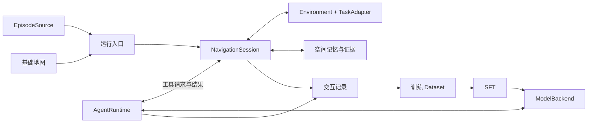

# 项目架构设计

本稿依据[近期计划](../Plan.md)与[Harness 草案](Harness.md)，重点确定模块接口和扩展方式。参考 [DThinkVLN](../../cache/arch/arch3/DThinkVLN.md) 的注册装配、环境／策略分离和训练数据链，以及[历史 NavCraft](../../cache/arch/arch3/NavCraft.md) 的共享导航会话。基础实验框架已实现，实际文件、接口与运行方式以[架构归档](../Architecture.md)为准；本稿仍包含尚未实现的地图、空间记忆与训练目标。

## 1. 设计主线

同一套导航执行逻辑用于教师采集、学生评估和未来在线训练。差别放在模型、任务适配器、样本来源和训练方法中，避免为每个实验复制 Agent 与环境。



图中的 `ModelBackend` 用于本地 Agent 循环。外部 runtime 可以自行管理模型连接，但仍需适配相同的导航工具入口；其记录能力另行检查。

## 2. 目录与代码归属

### 2.1 仓库根目录

```text
NavCraft/
├── src/                    # 可复用的业务实现与 Python 入口
├── scripts/                # 启动脚本：组织命令、进程和运行资源
├── config/                 # 数据准备、导航实验、采集与训练的 YAML 配置
├── tests/                  # 模块行为与接口集成测试
├── doc/
│   ├── Architecture.md     # 当前已实现架构及类接口索引
│   └── Design/             # 当前设计：Harness、项目架构及后续数据设计
├── data/                   # 外部存储链接：场景、任务集与整理后的训练数据
├── model/                  # 外部存储链接：基座模型与选定的模型权重
├── runs/                   # 外部存储链接：每次运行的记录、评估结果与训练 checkpoint
├── cache/                  # 可重建的地图／预处理缓存
```

这是目标布局，尚未存在的目录和文件随实现补齐。历史架构材料当前位于 `cache/arch/`。训练中间 checkpoint 放在对应 `runs/<run-id>/`，选定后再作为模型资产引用；共享数据与基座权重不由运行脚本覆盖。实际观察和教师交互记录属于 `runs/`，不能只存入可清理的 `cache/`。

### 2.2 scripts：启动哪些程序

`scripts/` 以简短 Shell 脚本为主，负责传配置、设置运行资源和启动进程；导航循环、样本转换和训练算法仍由 `src/` 实现。

| 建议脚本 | 调用对象 | 脚本负责的内容 |
|---|---|---|
| `run.sh` | `python -m src.bench.run` | 顶部变量引用五份配置，通过 Python 命令行参数启动单任务实验 |
| `smoke.sh` | 同上 | 串行运行四类固定首样本，分别保存结果 |
| `fake_smoke.sh` | 同上 | 使用 fake 环境与 scripted 模型检查完整链路 |
| `prepare.sh` | `python -m src.dataset.prepare` | 启动地图准备或训练样本导出，由配置选择准备任务 |
| `train_sft.sh` | `src.train.sft`，按需经 `torchrun` 启动 | 组织训练进程和 GPU 资源，透传训练配置 |
| `serve.sh` | 选定的模型推理服务 | 在独立推理环境中启动模型服务，设置设备和端口；接入本地推理时再添加 |

前三个脚本已实现；准备、训练和服务脚本按需补充。Bash 脚本不对外接收命令行参数：在顶部修改大写配置变量，使用已激活的 Conda 环境中的 `python`，不硬编码解释器路径。

```bash
bash scripts/run.sh
bash scripts/smoke.sh
bash scripts/fake_smoke.sh
```

脚本通过 `--task-config / --env-config / --model-config / --harness-config / --run-config` 向 Python 显式传参；Python 不从环境变量读取这些配置路径。GPU、服务、模型与预算放在对应 YAML 中，解析后的有效配置保存到运行记录。模型鉴权同样保存在 YAML，并按项目约定正常纳入 Git；运行日志和配置快照脱敏。

### 2.3 config：定义运行哪个实验

`config/` 保存可版本管理的实验配置，不存放执行逻辑、大型 episode 列表或训练数据本体。当前在线实验固定拆为五类：

| 子目录与示例 | 主要配置内容 |
|---|---|
| `task/` | `episodes` 与 `task`：数据源、样本选择、任务规则、命名评分协议 |
| `environment/` | `environment`：传感器、原子动作幅度、Habitat GPU 与 EGL 配置 |
| `model/` | `model`：服务协议、模型名、鉴权与请求设置 |
| `harness/` | `harness`：runtime 与工具集合 |
| `run/` | `run`：输出位置、请求／时间／上下文预算 |

小规模 smoke 可在配置中直接列出 episode ID；现有配置引用固定清单并取首样本。正式实验保留清单版本和原始 ID。后续采集训练轨迹须另选训练划分，不能将当前验证集 smoke 直接作为训练数据。

五份 YAML 各有明确字段归属，不按文件顺序覆盖，也不引入多层继承。地图准备、样本导出与训练入口及其配置尚未实现，后续按实际需要补充。

`src/common/config.py` 负责加载与检查，具体装配由各入口完成。每次运行保存解析后的有效配置到 `runs/<run-id>/`，包含实际模型、数据选择和生效参数，使脚本启动与直接调用 Python 入口得到相同的实验条件。

### 2.4 src：模块实现

```text
src/
├── common/
│   ├── register.py          # Registry 与各类注册表
│   ├── config.py
│   └── geometry.py          # 公用坐标／相机变换
├── environment/
│   ├── base.py              # 环境接口、Observation、Transition
│   ├── habitat.py           # Habitat 后端
│   ├── fake.py              # 无模拟器的流程验证后端
│   └── tasks/               # ObjectNav／VLN-CE／GOAT 的任务规则
├── dataset/
│   ├── episodes/            # EpisodeSpec、EpisodeSource、各数据源读取器
│   ├── scene_map/           # 离线基础图与特权监督素材构建
│   ├── training/            # 轨迹与空间任务样本、混合采样
│   ├── prepare.py           # 离线准备入口
│   └── collate.py           # 多模态编码与监督位置
├── harness/
│   ├── agent/
│   │   ├── base.py          # Runtime／ModelBackend 与消息接口
│   │   ├── loop.py          # 本地模型—工具循环，或所选基座的适配
│   │   ├── model.py         # 模型服务协议适配
│   │   └── context.py       # 活动上下文、压缩、图片裁剪
│   ├── tools/              # 导航工具实现及声明
│   ├── build.py            # 根据配置装配环境、会话、工具与 runtime
│   ├── session.py          # NavigationSession
│   ├── memory.py           # 空间实体、关系、证据引用与修订
│   ├── map.py              # 基础图契约与在线地图呈现
│   ├── trace.py            # 交互记录及读取；不依赖训练框架
│   └── prompts.py          # 导航初始提示与公开结果的消息构造
├── bench/
│   ├── run.py              # 样本选择、运行、教师采集
│   ├── evaluator.py        # 读取私有状态并生成评估结果
│   └── report.py
└── train/
    ├── sft.py              # 模型、Dataset、collator、trainer 装配
    └── rollout.py          # 后续在线训练接入点，按需要实现
```

基础版已采用 `harness/tools/` 与 `common/`，原来的两个空目录已移除。上述树仍表示整体目标归属，不要求一次建齐所有文件；实际文件树见架构归档。

接口类型随所属领域放置，不建立容纳全部业务类型的全局 `types.py`。只有确实修改模型结构时再增加 `src/model/`；模型权重仍在根目录 `model/` 外部存储中。

## 3. 注册与配置装配

沿用 DThinkVLN 的“名称 → 类或工厂 → 配置创建”方式。第一版 `Registry` 只需 `register(name)`、`get(name)`、`create(name, **kwargs)` 和 `list()`；重复名称报错，不做自动目录扫描或复杂插件发现。

| 注册表 | 可替换对象 | 示例名称 |
|---|---|---|
| `episode_registry` | 原始任务读取器 | `objectnav`、`vlnce`、`goat` |
| `env_registry` | 环境后端 | `habitat`、`fake` |
| `task_registry` | 任务目标、推进与评分规则 | `objectnav`、`vlnce`、`goat` |
| `runtime_registry` | Agent 循环或外部 runtime 适配器 | `agent`；其他按需加入 |
| `model_registry` | 单次模型请求的协议适配器 | `responses`；其他协议按需加入 |
| `tool_registry` | 导航工具实现 | 观察、动作、地图、记忆等工具 |
| `dataset_registry` | 模型训练 Dataset | `trajectory`、`spatial_qa`、`spatial_interaction` |

`episode_registry` 与 `dataset_registry` 分开：前者输出环境任务，后者输出训练样本。模型服务中的 checkpoint 名称属于配置，同协议下换模型无需注册新的 Agent。地图、记忆等暂只有一种实现的组件先直接构造。

注册方式示意：

```python
@env_registry.register("habitat")
class HabitatEnvironment:
    ...

task = task_registry.create(task_name, config=task_config)
env = env_registry.create(env_name, config=env_config, task=task)
```

各领域提供显式的注册加载入口，装配时导入选定实现；Habitat、训练框架等重依赖在构造对应组件时加载，读取训练样本或运行 fake 环境不应顺带启动模拟器。注册表只保存类／工厂，不保存跨 episode 共享的环境、会话或记忆实例。

当前配置分别描述 `episodes / task / environment / model / harness / run`，由五份明确角色的 YAML 提供。`harness/build.py` 注入依赖；工具内部不读取整份配置并自行创建模型或环境。

外部 runtime 自带模型管理时，配置由该适配器消费；不把它强行包装成一次 `ModelBackend.complete()`。装配时检查 runtime 支持的模型接口和记录能力，不能假定所有组合均可用。

## 4. 任务数据、环境与任务规则

### 4.1 两类 Dataset

| 接口 | 输入 → 输出 | 边界 |
|---|---|---|
| `EpisodeSource.load(selection) → Iterable[EpisodeSpec]` | 数据集与筛选配置 → 场景、起点、任务类型及任务载荷 | 保留原始 scene／episode ID，允许按流读取 |
| `TrainingDataset.__getitem__(index) → TrainingSample` | 已保存的交互或空间任务记录 → 模型条件与监督输出 | SFT 取样不推进环境，不消费或删除原始记录 |

`EpisodeSpec` 包含环境初始化与评分所需信息，其中目标真值、参考路径等仅供环境／评估使用。传给模型的是独立的 `PublicTask`，只包含当前目标文本／图片及任务允许公开的信息，不能直接序列化完整 Episode。

原始数据格式与任务规则分开：增加一个相同任务的新数据源，通常只增加读取器；改变目标推进或成功条件，才增加／修改任务适配器。

### 4.2 环境接口

```python
Environment.reset(episode: EpisodeSpec) -> Transition
Environment.observe() -> Observation
Environment.step(action: AtomicAction) -> Transition
Environment.finish_goal() -> Transition
Environment.metrics() -> EvaluationState  # 仅评估／奖励侧调用
Environment.close() -> None
```

- `Observation`：同一采样时刻的 RGB、depth、相机参数、位姿及帧引用。图像通过持久文件引用传递，不能只保存即将被覆盖的临时路径。
- `Transition`：新观测、实际执行反馈、公开任务、目标是否切换，以及 `terminated / truncated`。执行反馈描述实际发生的动作与碰撞；不包含到真实目标的距离或成功评分。
- `AtomicAction`：沿用已确定的原子动作协议。批量动作由工具按上限逐步执行，终止或目标切换后不继续执行旧目标剩余动作。
- `finish_goal()`：处理任务级 STOP／完成请求。局部移动结束不等于目标完成，自然语言“完成了”也不自动触发环境结算。

Habitat 内部的完整状态由后端持有。即使提供连续真实位姿，也不等于开放目标真值、全场语义或任意机位观察。模型、工具结果与私有评估记录保持分离。

### 4.3 TaskAdapter

任务适配器放在 `environment/tasks/`，由环境调用，主要提供：

| 方法 | 职责 |
|---|---|
| `reset(task_spec) → PublicTask` | 初始化目标序列和任务状态 |
| `on_step(private_transition) → TaskUpdate` | 处理动作后的任务变化与任务预算 |
| `finish(private_state) → TaskUpdate` | 按 benchmark 规则处理当前目标结束与后续目标 |
| `metrics(private_state) → EvaluationState` | 生成任务定义的评分事实 |

这里的私有状态可用于评分，但 `TaskUpdate` 只将公开变化交回 actor。GOAT 切换子目标不调用整场景 `reset()`；空间记忆继续保留。子目标成功、失败和超时如何推进均遵守数据集协议，不通过隐藏的成功检查反复引导模型尝试。

## 5. Agent 与导航会话

### 5.1 Runtime 与模型接口

```python
ModelBackend.complete(request: ModelRequest) -> ModelTurn
AgentRuntime.run(initial: AgentInput, tools: ToolSet,
                 trace: TraceWriter, limits: AgentLimits) -> AgentResult
```

以上是逻辑签名，具体采用同步或异步由选定基座决定。

`ModelRequest` 包含实际活动消息、工具声明、图像／其他公开模态引用及生成参数；`ModelTurn` 保留模型输出、工具调用、结束原因与用量。协议适配在 `model.py`，不混入导航目标判断。

Runtime 只认识消息和可调用工具：获取输出，执行工具，将结果追加到上下文，继续调用模型。导航业务不写进 Agent core。若接入现成基座，`agent/` 以适配为主，通用文件、命令、MCP 和 skill 能力沿用基座扩展方式。

外部 runtime 通过同一 `ToolSet` 回调接入。能完成导航不代表能导出合格训练数据；若无法导出实际上下文，记录中必须标明能力限制，不能将不完整日志冒充可复现的 SFT 输入。

### 5.2 会话与工具接口

```python
NavigationSession.start() -> AgentInput
NavigationSession.execute(call: ToolCall) -> ToolResult
NavigationSession.close() -> None

ToolSet.specs() -> list[ToolSpec]
ToolSet.call(call: ToolCall) -> ToolResult
Tool.spec() -> ToolSpec
Tool.execute(arguments, context: ToolContext) -> ToolResult
```

`NavigationSession` 持有环境、基础图、空间记忆、证据库和导航预算。`start()` 初始化环境与记忆；会话向 runtime 提供一个 `ToolSet`，其 `call()` 路由到 `session.execute()`，再分发给具体工具。

`ToolSpec` 声明名称、用途与参数；`ToolResult` 返回状态、文本／图片内容及是否结束整个运行。下一目标作为公开内容返回，不能把“当前目标结束”误标为整个运行终止。

`ToolContext` 只开放当前观察、动作执行、目标完成、地图、记忆和证据操作，不直接暴露包含评分接口和目标真值的完整环境对象。工具实现不反向调用模型；模型应由 runtime 决定何时再次请求。

同一环境的移动、完成与记忆写入按顺序执行，结果与对应调用 ID 关联。重试同一已执行调用时返回既有结果，避免一次请求被重复执行为两次移动。模型修正参数后的新调用则作为新操作记录。

### 5.3 状态由谁维护

| 状态 | 唯一事实来源／维护者 | 生命周期 |
|---|---|---|
| 当前 RGB-D、位姿、实际动作、任务进度 | Environment／TaskAdapter | 当前 episode；子目标进度按任务规则更新 |
| 房间／物体／关系及其证据 | `SpatialMemory`，经会话提交模型修订 | 同一环境 episode，跨连续子目标保留 |
| 基础平面图 | 离线 `MapAsset`，在线只读 | 场景／楼层 |
| 活动对话、摘要、图片裁剪状态 | Agent runtime／Context | 当前 Agent 会话 |
| 原始观察与交互记录 | `TraceWriter` 及证据文件 | 运行结束后仍可读 |

会话读取环境的真实位姿用于地图呈现，模型不得用记忆更新覆盖该位姿。物体位置等模型估计与传感器提供的事实应在记录中区分来源。

## 6. 空间记忆与地图接口

```python
SpatialMemory.update(patch: MemoryPatch) -> MemoryRevision
SpatialMemory.query(query: MemoryQuery) -> MemoryView
SpatialMemory.evidence(reference) -> Evidence
MapView.render(pose, memory_view, options) -> ImageRef
```

暂只固定“查询、修订、取证、呈现”四种操作。具体实体字段、检索算法及是否提供地图路径查询由后续 Harness 设计决定，不为此先建多个抽象存储后端。

`MemoryPatch` 引用实际获得的证据；更新产出版本，便于解释某次路线判断依据哪一版记忆。结构和引用校验不能等同于语义或几何正确性，模型错误的空间判断仍需通过后续观察或评估发现。

基础图的 `MapAsset` 至少约定场景／楼层、坐标变换、尺度和可通行区域含义。不同历史项目的坐标与地图 schema 经离线适配后再加载；在线地图由只读底图叠加模型记忆构成。

`scene_map/` 可利用全场标注生成监督素材，但在线公开的基础图与私有标注分别导出。完整语义图不能直接作为 Agent 已探索获得的空间记忆。

## 7. 运行记录如何接到训练

### 7.1 记录模型真正做过的决策

每个决策记录关联 `episode_id / goal_id / request_id`，包含：

1. 实际送入模型的规范化请求：消息、工具声明、图像引用、压缩摘要与公开模态信息。
2. 可获得的模型输出和工具调用，以及对应的真实工具结果。
3. 导航动作的实际执行反馈、记忆修订和任务变化。

评估真值另存，由结果关联到 episode，不混入模型请求。图片可共用持久文件，文本输入可以保存快照或可还原的引用；不能只保留最终地图、最终摘要或物理轨迹。

压缩／裁剪发生后，下一条记录应反映裁剪后的真实输入。训练转换时不能从完整历史重新拼出一份信息更多的上下文。原始记录也不应因对话裁剪而删除。

### 7.2 从记录构造 SFT 样本

第一版以一次模型请求为监督单位：

```text
模型当时的输入条件 → 当次可训练的 assistant 输出／工具调用
```

一条完整教师导航轨迹可拆成多个这样的样本。工具返回、用户输入和作为条件的历史消息不计为当前预测目标；监督位置由 Dataset 明确交给 collator。闭源教师不可获得的内部推理不作为必需字段。

`TrainingSample` 保留消息、工具声明、模态引用、监督范围和来源信息；轨迹 SFT、空间 QA、多轮查询／移动任务共用这一契约，通过不同 Dataset 构造样本。若任务需要交互，交互在采集阶段完成，SFT 读取保存结果。

教师与学生的 chat template 可以不同，但公开信息、工具含义和模态顺序应保持一致。学生在线编码与训练 collator 共享其 processor／模态处理约定，不能各自维护一套 pose 或图像打包逻辑。

DThinkVLN 提示了一个具体风险：采样时带有 pose，并不保证训练重算概率时仍带有 pose。因此后续新增空间输入通道时，需要同时接通在线推理、样本编码和训练，而不只是修改模型类。

### 7.3 后续 RL／OPD 的接入位置

`train/rollout.py` 复用 `build.py`、导航会话与工具，实现当前策略的环境交互；奖励侧读取私有评估信息。训练算法不另写一套动作控制或记忆更新路径。

具体采样、概率记录、优势和损失由训练方法确定，当前不照搬 DThinkVLN 的候选择优执行。部署评估使用模型自己的决策；若训练引入教师介入或特权动作选择，要在轨迹中明确记录。

## 8. 装配与扩展怎么发生

一次在线运行由 `bench/run.py` 选择 Episode 与配置，调用 `harness/build.py` 创建环境、任务适配器、地图、会话和 runtime。会话初始化后启动 Agent；运行结束先读取评分，再关闭环境与记录器。教师采集使用相同入口并保存训练所需记录。

`AgentResult` 记录 runtime 的退出原因。模型提前结束回复、工具执行失败和任务正常结束分别记录；不能在模型未申请完成时替它补一个 STOP，或把解析错误当成完成。

`bench/evaluator.py` 负责结果整理和评分调用，不承担模型消息构造或导航控制。正常评估逐次记录 episode 结果；重复运行与择优汇报必须分开，不能隐式沿用旧项目的多次择优口径。

| 要做的扩展 | 主要修改位置 | 需要保持的接口 |
|---|---|---|
| 换教师／学生 checkpoint | 模型配置；不同协议才增加 `ModelBackend` | 同一工具、观测和执行条件 |
| 增加新的任务数据源 | `dataset/episodes/`＋注册 | `EpisodeSpec` |
| 增加新的任务规则 | `environment/tasks/`＋注册 | `PublicTask / TaskUpdate` |
| 增加导航操作 | `harness/tools/`；必要时补记忆或地图操作 | `ToolSpec / ToolResult` 与执行记录 |
| 增加空间训练任务 | `dataset/training/`，必要时增加采集逻辑 | `TrainingSample` 与同一在线操作语义 |
| 更换上下文策略或 runtime | `harness/agent/` 或对应适配器 | 工具回调、实际输入记录 |
| 增加并行运行 | `bench/` 调度 | 每个 episode 独立环境、会话和记录目录 |

第一条需要跑通的完整链是：**读取少量 Episode → 使用 Harness 导航 → 留下可还原记录 → 导出 SFT 样本 → 训练后的模型接回同一 Harness。** 先实现这条链实际用到的注册项和接口，其余扩展按任务需要加入。
