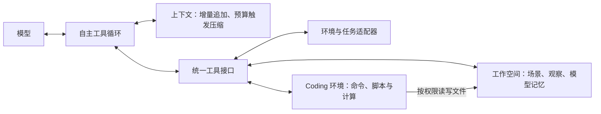

# 导航 Harness 架构设计

更新：2026-10-14。本文定义 **目标 Harness、工具、工作空间、Coding 环境与上下文管理**，围绕导航中的信息使用与自主行动设计。空间记忆的具体形式、字段与样例单独维护在 [SpatialMemory.md](SpatialMemory.md)；论文主线见 [Paper](Paper.md)，数据设计见 [Tasks](Tasks.md)，评测见 [Experiments](Experiments.md)。

本文同时说明现行实现边界与目标规范；软件验收见 [Harness 实施记录](Agents/HarnessImplementation.md)，导航效果和训练收益由独立实验验证。

<a id="harness"></a>

## Harness 目标架构

一个自主 Agent、一套以文件保存的空间记忆，以及基座原生 Coding 工具和导航扩展。模型自主决定查询、观察、计算、更新记忆和移动的顺序，不按定位—规划—执行设置固定调度。

这套结构同时支持空间问答、局部交互、完整导航，以及**在给定基础墙图上构建和修订语义地图**。任务决定初始资料、可写范围、工具与结束条件，模型与工具循环保持一致。空间能力由模型学习；Harness 负责让证据可读取、地图可更新、动作可执行。



| 组成 | 职责 |
|---|---|
| 运行循环 | 调用模型、执行所选工具、追加反馈、控制预算和记录交互；不替模型安排导航步骤 |
| 上下文 | 平时只追加，接近预算上限时统一压缩；不每轮重新载入工作空间 |
| 工作空间 | 保存只读初始资料与唯一当前地图／实体记忆；检索和绘图使用相同 ID、坐标及当前记录 |
| 环境与任务适配器 | 提供当前公开任务、真实观察和动作反馈，处理结束及目标切换；私有评分不进入反馈 |
| 模型 | 建立空间对应、选择证据、规划、维护判断并组合工具；程序不自动提供定位与正确路线 |

<a id="framework"></a>

### 开发基座：优先复用完整 Pi Coding Agent

**基座采用本地维护的 Pi `pi-coding-agent`，目标边界是 Python 主程序＋独立 TS Core。** Python 主导任务、空间记忆、导航工具、环境、评分与实验组织；TS Core 保留 Pi 的自主循环、模型协议、原生 Coding 工具、会话与压缩。导航工具通过通用接口接入，不把导航任务判断写入 Core。当前已实现 Python 启动并管理独立 Node Core；导航工具定义、环境和实验编排位于 Python。[本地 Pi SDK 文档](../src/agent-core/pi/packages/coding-agent/docs/sdk.md)

Pi SDK 在独立 Node 进程内运行，通过双向 JSONL 与 Python 主程序通信；模型选择导航工具时回调 Python，Python 返回实际结果与公开状态。Pi 持有唯一模型会话，Python 保存审计记录，不另维护第二套对话。Python 的 episode worker 直接持有 Habitat，工具回调在初始化环境的同一线程执行；不再增加 Python 环境桥进程。本地维护的 Pi 核心源码、外部安装依赖和模型任务工作空间分别放置；Pi 源码位于独立 Core 中，普通依赖在仓库根目录。

完整 Pi Fork `chensunlai/pi-navcraft` 作为 Git 子模块保存在 `src/agent-core/pi/`，NavCraft 固定使用其某个提交。Fork 的 `navcraft` 分支基于 v1.2.0 维护修改，并保留官方 `upstream`。npm workspace 只链接 `packages/coding-agent`；其他 Pi 包与普通依赖仍从 npm 安装到 NavCraft 根目录的 `node_modules/`，不纳入版本控制。所有 npm 安装、构建均在 NavCraft 根目录执行，不启动 Pi 全仓构建。修改 TypeScript 后重新编译；Node 复用现有 nvm。初次获取使用 `git clone --recurse-submodules`，已有克隆执行 `git submodule update --init --recursive`；Pi 源码提交与 NavCraft 的子模块指针分别管理。

### 现行代码边界与运行入口

```text
src/harness/             Python 任务入口、空间记忆、导航工具、环境会话、实验记录
src/agent-core/          独立 TS Core、原生 Coding、模型协议、会话与压缩
src/agent-core/pi/       完整 Pi Fork 子模块，仅链接其中 packages/coding-agent
src/common/map.py        地图校准，仅用于可信初始化和私有核验
src/environment/        仿真、动作执行和任务适配
src/dataset/            数据集读取、离线构建与修订；qa_campaign/ 保存本次目标视点构建与核验图册
src/bench/              加载已准备的数据、组织评测和私有评分；不生成或优化数据集
```

数据构建与评测分开执行：离线准备把目标、成功视点、路线约束及来源写成完整文件；Harness 和 bench 只加载已有文件，不隐式调用构建器。Qa 连续任务的准备入口为 `python -m src.dataset.qa_campaign.build`，运行时通过 `sequence --scenario .../scenario.json` 明确选择版本。

运行入口为 `python -m src.harness doctor/run/smoke`，npm 负责安装、构建和 Core 测试。`smoke` 默认顺序运行 Coding、局部 IA、压缩续接；完整案例使用 `smoke --suite full`。沿用 `config/harness-pi` 配置目录。

2026-10-15 已暂时移除旧 `src/legacy/` 及依赖它的执行入口、脚本与专属测试。旧代码可从 Git 提交 `92ae3e0` 恢复；已有数据、当前 Harness、通用数据格式与导出、离线报告保留。旧原子数据采集／重放需要后续适配当前 Harness，不能继续调用原入口。

Python 注册工具名称、说明、JSON Schema 和执行函数；Core 只创建通用代理。原生文件／命令工具留在 Core，Python 提供读写目录与 Python 可执行路径。初始化、工具回执、实际模型事件通过双向 JSONL 交互；等待模型执行期间持续接收工具请求。

任务完成或目标切换后，先记录当前结果，再为本批剩余调用产生未执行回执；正常结束在工具批次边界生效。GOAT 切换后由下一轮模型重新决定，Core 不解释目标语义。异常取消与正常完成分别记录。

Pi 持有唯一模型历史；Python 写唯一 `private/trace.jsonl`，保存 Core 实际事件、工具回执与文件版本引用。压缩后公开内容由 Python 提供，Core 原样恢复，不自动定位或改写记忆。每个 episode 使用独立请求账本，普通推理、摘要与失败请求共同计数；本轮不设全局请求总上限，旧 191/200 账本保留。

CLI 监督独立 episode worker；worker 直接运行 Habitat 并启动 Core。超时先正常取消，超过宽限时间回收整个 episode 进程组。Coding 隔离仍使用 bwrap，不回退宿主执行。

| 候选 | 与本项目的关系 |
|---|---|
| **Pi coding-agent SDK** | 首选。提供完整 Coding Agent 会话，支持工具扩展及多种模型服务，适合教师与后续开源学生共用运行机制 |
| Codex App Server／SDK | 若优先原样复用 Codex，可直接使用其运行层并接入导航工具；自定义服务需满足其 Responses 协议要求 |
| 仅 pi-agent-core 或自行写循环 | 更底层，仍需补齐 Coding 工具、会话和压缩；本轮不以重建这些能力为目标 |

Pi 的 [agent-core](https://github.com/earendil-works/pi/blob/main/packages/agent/README.md) 提供基础循环；完整会话能力在 coding-agent 层。Pi 可配置 [兼容模型服务](https://github.com/earendil-works/pi/blob/main/packages/coding-agent/docs/models.md)。Codex 的 [App Server](https://developers.openai.com/codex/app-server/) 提供会话、MCP 和动态工具接入，[自定义 provider](https://developers.openai.com/codex/config-reference/) 当前使用 Responses 协议。这里的取舍是可控性和跨模型适配，不是预先认定哪个框架导航更强。

实施时固定一个核验过的发布版本；当前官方包名为 `@earendil-works/pi-coding-agent`。保留基座原生工具参数和调用／反馈结构，追加导航任务约定；不要求保留不适用的“修复代码仓库”任务指令。Skills 用于按需提供地图格式或工具用法，不强制固定导航步骤；MCP 按接入需要启用，不必为已有本地工具再增加一层。

**框架不会自动保证模型性能。** 当前服务使用明确核验的 `gpt-6.1-sol` 标识，Responses/high/8192；原 `gpt6.1sol` 标识曾返回 404。真实 Coding、局部 IA、查询 QA 和压缩续接均已运行，结果只证明相应链路可用，不保证任意模型导航效果。

### 模型输入与输出

| 初始输入 | 字段／内容 |
|---|---|
| `task` | `goal_id`、`type`、`instruction`、可选 `image_ref`；正式任务由环境维护 |
| `observation` | `frame_id`、`step`、RGB 图片引用；不自动标注当前房间或可见实体真值 |
| `scene`／记忆入口 | 本任务开放的基础墙图、坐标约定、可选预建实体与证据；当前记录位于 `memory/`，不一次加载全部卡片和图片 |
| 初始定位提示 | 完整导航默认提供起始位置与朝向箭头；原子任务按能力要求提供或隐藏，仅对初始化时刻有效 |
| 工具与预算 | 可用工具、动作名称／步长／转角／俯仰范围、观察成本及调用／运动预算；不支持的动作不开放 |

上述为可用输入项，具体任务决定提供哪些资料。后续输入来自工具：实际读取的文字与图片、修改结果、新 RGB 和实际动作反馈。默认视觉协议不持续提供真实 pose、相机矩阵或 depth；补全构图功能不改变这一条件。文件和图片使用工作空间相对路径；实体 ID 对应当前记录，图片 ID 通过公开索引找到路径。

模型输出为工具调用或可见文本回答。简单 QA、查询 QA、交互 QA、交互 IA 和完整导航采用一致的空间表示与工具语义；任务限定资料与可用操作，模型自主决定范围内的调用顺序。直接 QA 不开放工具，其他形式也不要求调用全部工具。结束条件为：

| 任务 | 结束方式 |
|---|---|
| 三类 QA | 提交最终回答后结束，正确性另行核验；普通工具间的说明文字不作为提交 |
| 局部 IA | 指定空间事件达成时由任务适配器结束，立即停止剩余动作；预算耗尽也结束，不要求模型学习 STOP |
| 完整导航 | 显式调用 `nav_finish`，按原任务协议结束或切换目标；文字自称完成不代替该调用 |

结束通知与成功评分分开；目标切换不表示上一目标成功。私有评分、正确方向和距离梯度不作为继续执行时的提示。

### 一次任务如何运行

1. **初始化。** 建立工作空间和逻辑会话，提供当前目标、初始观察、定位提示及资料入口。将任务允许的预建实体初始化到当前记忆；只有墙图时从空实体表开始，不自动导入未公开语义。
2. **自主交互。** 模型选择工具或回答；Harness 执行并追加真实结果，自动保存实际交互与原始观察。模型可按需新建或修订地图实体、查询证据、计算及移动，不要求先建完图或每步更新。
3. **按预算维护上下文。** 接近输入预算或服务图片上限时统一压缩；旧资料按引用仍可重开。
4. **结束或切换目标。** 遵守任务协议。GOAT 连续目标保留机器人实际状态、观察历史和环境记忆；新目标追加到上下文，旧目标下的子目标与计划不再生效，由模型按需更新。位置估计仍绑定原观察时刻。独立 episode 默认重新初始化。

例如，模型可以先将当前门框与地图 D03 对应，查证据图确认，将本帧位置估计写入状态，再选择穿门动作；移动后依据新 RGB 和动作反馈检查、修正判断。局部证据充分时可以直接行动，精确定位、写入状态和使用 Python 都不是行动的前置条件。这个例子说明能力如何组合，不规定每轮都要完成这些步骤。

## 工作空间与 Coding 环境

```text
workspace/
├── scene/                 # 只读：基础墙图、坐标约定、获准初始资料
├── observations/          # Harness 自动追加：运行图片、动作和反馈索引
├── memory/                # 模型主动维护
│   ├── maps/              # 各楼层当前区域／出入口／物体图元
│   ├── entities/          # 按 ID 保存唯一当前卡片，允许新建与修订
│   ├── state.json         # 当前定位估计、子目标、未解决问题
│   └── notes.md           # 可选：其余值得保留的笔记与经验
└── scratch/               # 脚本、计算结果、临时图片
```

`scene/` 只包含本任务允许提供的公开资料，不直接挂载场景 `raw/`。`observations/` 保存实际发生的事实；`memory/` 保存当前地图、模型解释与意图。初始实体的图元与卡片一起复制到当前记忆，此后不再采用“只读卡片＋补充文件”合读的方式。三种记忆的字段与具体样子见 [SpatialMemory](SpatialMemory.md)，目录仅区分来源和写入权限，不新增一套记忆分类。

**每个任务声明初始资料、可读资源和可用工具，所有工具使用同一信息范围。** A01 不提供的初始位置不能经 `render_map` 重画出来；仅给地图图片的题目不能经 Python 读取未公开的数值图元；查询 QA 的外部资料在开始时固定。搜索、目录列表与图片索引也只展示获准资料。

**正式记忆统一保存在文件中。** 模型通常用基座的 `write`／`edit` 新建或修改，脚本写入也遵守相同权限并记录变化。每个实体只有一份当前几何和一张当前卡片；删除后不从初始资料自动恢复。给定墙体保持只读，模型可修改任务允许的区域、出入口和物体记录；文本修改不会自动调整几何或位置估计。旧内容用于审计和训练回放，不另设运行期版本查询。

**Coding 采用基座原生文件与命令工具，工作空间内提供 Python。** 模型可以读取资料、编写脚本、执行计算、检查输出并修改重跑。脚本和临时产物放入 `scratch/`；需要持续使用的判断写入 `memory/`，不另建隐藏的解释器状态。Python 是可执行环境，不再要求单独的 `python(code)` 工具。

命令返回输出、错误与退出状态，生成的图片经读图工具查看。文件工具和命令执行都只访问任务公开工作空间：`scene/`、`observations/` 只读，`memory/`、`scratch/` 可写；模拟器、评分和服务密钥在该范围之外。真实观察／运动统一经导航工具。**仅设置工作目录不等于限制访问范围**，需由执行环境落实权限；Pi 本身不提供这一隔离保证。[Pi 执行边界](https://github.com/earendil-works/pi/blob/main/packages/coding-agent/docs/security.md) 教师与学生获得相同的工具语义和执行能力。

<a id="map-building"></a>

### 地图如何构建并参与导航

模型在真实观察中辨认已知／新实体，用同一个 ID 关联当前图元、卡片及证据帧。几何不确定时允许 `geometry: null`，先保留描述和证据，定位后再落图。模型可调整 box、补全区域和门连接、合并重复实体，并修正相关引用；新观察来自导航工具，写文件本身不产生新视觉证据。

`render_map` 读取**干净的基础墙层＋当前实体图元＋`state.json` 中的位置估计**。基础层不含旧物体与标签，当前实体变更后绘图随之变化；渲染器不猜位置、填补未知区域或推断可达性。连接和阻挡状态保存在实体卡片中，是否沿该连接行动仍由模型判断。具体字段、未知状态和纠错规则见 [空间记忆的在线构建](SpatialMemory.md#map-building)。

例如，模型发现柜子后可先创建卡片并引用本帧；取得足够位置线索后写入 box，绘图核对；换视角发现错位后修订，在后续选路时读取修正后的地图。也可以先行动后补充记录。构图与导航共享同一工具循环，不设每轮必经的构图阶段。

<a id="tool-design"></a>

## 工具设计

优先沿用基座原生 Coding 工具，导航部分通过扩展注册。以下定义必要能力；不为凑固定工具数量重复实现基座已有操作。

| 工具 | 输入 | 输出／效果 |
|---|---|---|
| `read`（原生） | 文件路径、可选读取范围 | 文本或支持的图片内容；沿用基座参数与反馈 |
| `write`／`edit`（原生） | 文件路径、内容或替换文本 | 新建／修改当前地图、实体卡片、状态或脚本，保留原生反馈；记录实际文件变化 |
| `bash`（原生，工作空间内） | 命令、可选超时 | 查询目录／搜索文本、执行脚本，返回输出与退出状态；沿用基座的截断和续接机制 |
| `view_images` | `refs`、可选 `crops`、`layout` | 查看已有图片或其裁剪／拼图并返回来源；观察图保留原采集时刻，未知时标明；不采集新观察 |
| `render_map` | `map_id`；可选 `region`、`highlight_ids`、`grid` 与图层选择 | 绘制基础墙层、当前实体及定位估计；返回图片引用、原图坐标范围、所用记录版本和估计对应帧，不自动重定位 |
| `nav_observe` | `mode: single/panorama` | 从当前环境获取新 RGB、帧引用、步骤与视角说明；全景默认拼图并保留各视图引用，原地采集也属于新观察 |
| `nav_step` | `actions`：任务允许的短原子动作序列 | 请求与实际执行动作、碰撞／中断、末帧 RGB、中间帧引用、相机视角与剩余预算；不返回真值位姿变化 |
| `nav_finish` | `goal_id`：提交当前目标完成 | 核对 ID 是否仍是当前目标，再按任务协议结束或返回下一目标；成功与否另行评分，不作为后续行动提示 |

- **图片与引用一起返回。** `view_images`、`render_map`、观察和运动工具直接附上本次图片；`view_images` 主要补充多图、裁剪与来源说明，单图也可用基座 `read`。脚本生成的图片按路径打开，命令文字不能代替图像输入。
- **复用通用能力。** 搜索和目录查询可直接使用命令；若启用基座已有 `grep`／`find`／`ls`，不再新增同义的导航搜索工具。文件变化统一记录，不依赖某一个工具名才被保存。
- **绘图只显示记录。** `render_map` 读取当前图元和状态，更新后不要求立即重绘；缺少几何的实体列为未定位，不画到原点。`region` 使用原地图归一化坐标，缩放后保留坐标映射；`grid` 用于读数，`highlight_ids` 仅突出指定实体，不自动寻找目标。旧位置估计保留对应时刻。
- **动作反馈报告事实。** 请求动作与实际执行动作分别记录。短批次建议限制为 1–6 个原子动作，碰撞／目标切换／结束可中断；中间观察归档，模型按需回看。执行过前进命令不代表实现了额定位移，模型需结合反馈判断。
- **动作与相机控制分清。** 初始化声明前进、左右转向等允许动作及其幅度；环境支持且任务允许时，将 `look_up/look_down` 加入 `nav_step`，不再让 `nav_observe` 另有一套持久相机控制。俯仰改变相机视角，不改变机体地图朝向；不支持的开门、瞬移或移动到坐标等操作不开放。
- **环境操作保持有序。** 同一环境的观察、移动与目标提交按顺序执行，避免并发工具使图像和动作对应错位。
- **视角语义明确。** 单帧来自当前相机状态；全景默认采用同一位置的六个水平视图，返回相对机体的水平角和俯仰角，恢复拍摄前机身／相机状态。全景是观察组，不能将最后一个侧向视图当成机体转向后的正前方；具体成本由任务协议明示。
- **结果保持紧凑。** 普通操作返回本次结果和必要引用，不每次附上全图、全部状态和待办列表。地图与目标图仅在初始化、主动调用或目标切换时进入上下文。

### 导航还需要哪些辅助能力

| 需要的辅助 | 提供方式 | 边界 |
|---|---|---|
| 看清局部、比对当前与历史证据 | `view_images` 裁剪／并排；`render_map` 局部放大、ID 高亮与坐标网格 | 图像裁剪坐标相对各自原图；返回尺寸及来源，不将缩放后的点当成原图坐标 |
| 回查动作、观察与实体 | `read/bash` 查询公开帧／动作索引和当前实体目录 | 不增加同义搜索工具，不读取私有日志 |
| 坐标换算、方位计算、候选路线草图 | 工作空间内的 Python 脚本，结果用读图工具查看 | 只用公开地图、模型估计和已记录连接；计算出的路线不等于真实可通行 |
| 检查地图能否被正确读取 | 提供一项通过 `bash` 运行的轻量记忆检查入口 | 返回出错文件、字段／ID 与原因；检查 JSON、坐标格式、ID 和声明的引用，不评判空间答案 |

检查入口与绘图复用同一套格式规则；绘图相关记录不合法时返回具体错误，不悄悄显示上一版地图。自由文本不强行转成关系数据库，文件允许分次编辑；无需每次写入都校验或因笔记错误禁止观察、运动。没有必要另设实体增删改、自动定位或自动导航工具；几何计算可借助代码，证据对应与行动选择仍由模型负责。

### 最小验证：检查操作能否形成闭环

**开发中测试导航、工具、Coding、上下文压缩和目标切换等其他功能时，直接使用 `data/scene_maps` 中已建好的地图、实体描述与证据，按任务公开范围初始化当前记忆。** 保留运行中的定位、计划和记忆更新能力，无需每次从墙图重新构建，也不将构图效果作为其他功能测试的前置条件。

**记忆构建只做独立的局部专项测试。** 在一个房间或相邻局部区域，用只有墙图或部分实体的输入检查：模型根据实际观察新建实体和证据引用、绘制地图、用新视角修订并在后续判断中重新使用。另检查未知几何不被猜画、删除实体不从初始资料复活、错误格式明确报错、修改后旧图片仍可追溯。构图的空间正确性再用私有资料核验，不以“成功写文件／画图”代替。本阶段不要求全场景重建或边探索边完整建图。

这些是功能与信息边界的验收，不要求教师每次完整采用相同顺序，也不代表构图或导航成功率已验证。记录更新发生的真实时刻；任务结束后补图不算导航期间使用了在线记忆。

<a id="context-management"></a>

## 上下文管理

**同一 episode 一个逻辑会话：平时只追加，接近预算上限时统一压缩。** 外部记忆保存完整资料，上下文保存实际加载的部分。不按“最近五组”滚动删图，不每轮重新组合输入。

使用本地 Pi 的会话与原生压缩机制，**压缩提示直接修改 Core 源码**，不在外围额外追加一套摘要指令。提示统一位于 [Core compaction.ts](../src/agent-core/pi/packages/coding-agent/src/core/compaction/compaction.ts) 的共享摘要构造入口，覆盖首次摘要、已有摘要更新和 split-turn 前缀摘要。下述信息保留方式仍需验证；不另写压缩引擎。外围仅保留统一请求预算、审计和已有公开图片/状态恢复。Pi 与 Codex 的压缩实现不要求完全一致。

### 初始与增量形式

```text
初始化：固定规则与工具约定
      ＋当前任务／目标图
      ＋初始 RGB 与定位地图提示
      ＋记忆入口

后续：模型输出／工具调用
    →工具文字反馈与实际图片
    →模型下一次输出……
```

任务切换、文件更新和位置修正都在末尾追加结果，不回写早期消息。模型可以在形成重要对应或遇到矛盾时写记忆，无需每走一步保存笔记。旧图片不覆盖，重绘生成新引用，避免历史输入随文件变化。

“当前观察”指最近实际采集的环境观察。回看历史图片或重绘地图不会更新这一时刻；压缩时保留的最新观察也按采集时刻确定，不能将最近打开的旧图当作眼前画面。

### 缓存约定

保留文字不等于保留其 KV 缓存。常见提示缓存依赖相同的请求前缀；删除较早图片后，从最早变更处开始，后续分析通常需要重新计算，即使分析文字还在。变更之前的相同前缀仍可能命中缓存。[OpenAI 缓存说明](https://developers.openai.com/api/docs/guides/prompt-caching/diagnostics)

因此，不再用固定图片组数触发常规剪枝。规则与工具定义保持稳定，每轮追加模型输出和真实工具结果，尽量复用已有前缀。实际缓存命中仍取决于服务后端；追加式上下文也会增加注意力计算和显存占用，不能保证越长越快。

### 何时压缩、保留什么

只设一套上下文维护策略，阈值按所用模型配置，并为输出和下一轮工具反馈预留空间：

当前按用户确认的 128k 输入能力，将窗口配置为 **128000 token、约 100000 token 触发压缩、近期交互预算 20000 token**（`config/harness-pi/default.yaml`）。Pi 在交互边界按上下文估算触发，100k 不是每次请求的精确硬截断；正常运行仍只追加消息。压缩专项可临时降低阈值，完成后恢复上述配置；历史 64k 测试记录保留原值。

| 时机 | 处理 |
|---|---|
| 未接近预算上限 | 只追加，不因图片变旧而删除；全景默认发送带方向标签的拼图，细节按需读取 |
| 接近输入预算或服务图片上限 | 同一次处理中摘要较早历史、移出旧图片，保留完整的近期交互；不另设周期性图片剪枝 |
| 压缩后 | 在新上下文上继续追加；原始记录和图片保留在工作空间及日志中，按需重新读取 |

压缩后的上下文为：

```text
固定规则与工具约定
当前任务、必要地图／目标图、最新观察
历史摘要：进度、关键判断及证据、未解决问题、文件入口
预算内的近期完整交互
随后追加的新交互……
```

近期交互按完整模型输出及其全部工具回执保留，不能截断调用配对；图片已包含在保留交互中时不重复添加。不硬性规定保留五轮，所保留内容必须满足压缩后的预算。旧位置注明对应时刻，不能作为当前位置；必要地图也不因保留而获得实时定位。

摘要交接继续行动所需的判断与资料入口，可概括并引用已保存记录；不自动重写空间记忆，也不要求重复抄录记忆文件。压缩成功且新输入满足预算后才替换旧历史。保留实际使用的摘要和上下文，并按协议保留可续接输出；不可读 reasoning 不转成训练文本。

**压缩仍会使变更位置之后的旧 KV 无法直接复用。** 本方案减少这种重建的频率，不承诺消除它。落地后观察实际缓存 token、输入规模和每轮延迟，再调整一个输入预算阈值。

<a id="compaction-prompt"></a>

### 导航压缩提示词（临时适配，待研究）

**导航中的上下文压缩仍需专门思考，当前提示词不是最终方案。** 导航要求直接放入本地 Pi Core 的摘要提示，沿用原生摘要结构、历史切分与会话保存。这里使用本地源码分支，后续改提示或压缩机制直接修改该源码并构建；外围不再负责提示注入。分支切换摘要有独立生成入口，本次没有修改。

以下为临时附加提示词，供最简实现使用；它表达希望保留的信息，不代表这些要求已能可靠满足：

```text
请为导航 Agent 整理可继续执行的简短交接摘要，只总结给定历史和已有摘要，不执行任务或产生新计划。
在原摘要结构中，优先保留以下实际存在、仍影响后续决策的信息；缺失项不补造，不必逐项填表：
- 任务目标与 goal_id、执行约束、实际进展；区分已提交、已切换和经反馈确认的结果。
- 被压缩历史中的最新观察引用与采集时刻；位置／朝向估计另注明对应帧及是否确定，不将旧估计写成实时位置。
- 仍有用的观察—地图—实体对应与空间关系，保留实体 ID、证据帧、参考系和必要的不确定性。
- 影响继续执行的实际动作效果、碰撞、未解决疑问，以及容易再次误用的已否定判断；不把请求动作当作已实现位移。
- 关键地图、证据、记忆文件及可继续使用的脚本／产物路径，和历史中已有的下一步意图；不要复制整个资料库。
这份摘要只代表所总结历史截至的状态，后续保留消息中的更新仍应生效。
保留事实、模型估计和计划的区别；不依据图片路径推测画面，不提高结论确定性，不修改记忆文件。
```

**提示词不能代替图片保留。** 核查的 Pi 默认摘要流程将历史转换为文本，不会重新看完旧图。因此模型此前未说出或保存的视觉细节可能丢失；原图应继续可检索，最新实际观察按上文规则留在压缩后输入中。压缩测试检查“待确认的门没有变成已确认、旧位置没有变成当前位置、关键图片仍可打开”，而不只检查摘要是否生成。

后续再研究多模态证据如何取舍、摘要与空间记忆如何配合，以及多次压缩对判断和导航表现的影响。本轮记录实际行为与限制，先完成最简重构，不以一次续接成功认定压缩设计成立。

### 与数据导出的关系

每条样本保存初始上下文、当时可读的记忆版本、实际模型输入输出、工具调用与回执、文件修改，以及最终回答／局部事件结果。训练目标为可见模型回答和工具调用；图片、工具反馈及当时的文件内容作为条件。不能用 episode 结束后的记忆覆盖早期版本，也不能加入未来观察或私有答案。四种局部任务形式与三种记忆的对应见 [SpatialMemory](SpatialMemory.md#task-forms)。

<a id="spatial-memory"></a>

## 空间记忆入口

平面图、文本和证据图片的具体定义、字段与样例已独立到 [SpatialMemory.md](SpatialMemory.md)。本入口保留旧链接，不重复维护第二份规范。

## 设计参考

- [NavHarness，工具与文件访问](https://arxiv.org/html/2609.34276v1#A1.SS2)：借鉴持久文件资料和按需读取，不照搬其会话权限或 SLAM／占据图输入。
- [NavProbe，实体与证据记忆](https://arxiv.org/html/2609.27526v1#S3.SS2)：借鉴紧凑实体描述关联原始证据，不照搬固定的 executive／skill 执行阶段。
- [ASENA，代码与工作空间](https://arxiv.org/html/2609.39207v1#S3.SS1)：借鉴计算、可视化和脚本产物；本项目仍训练导航主控，代码执行的收益需要单独验证。
