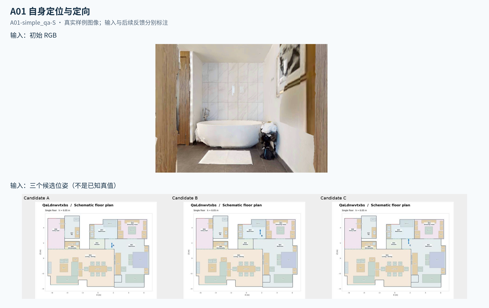
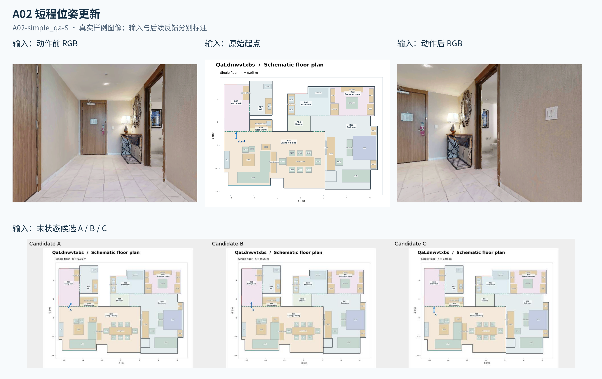
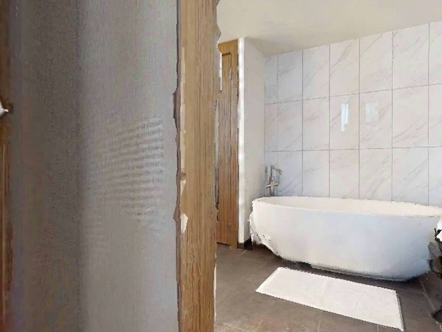
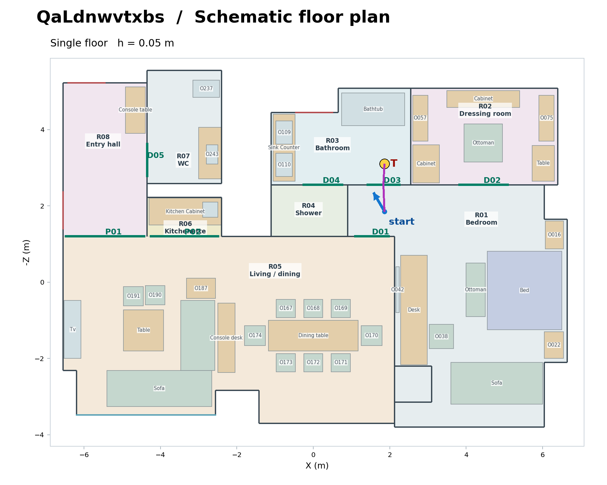
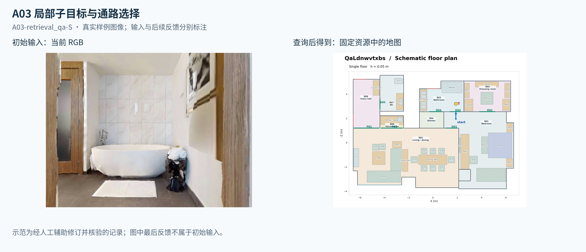
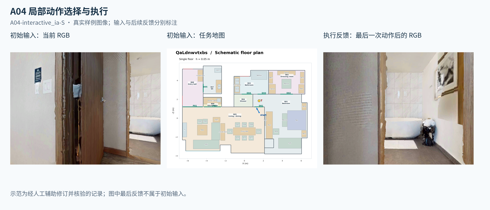
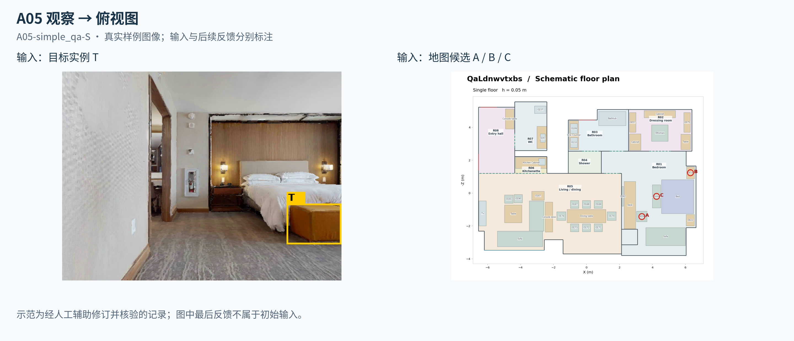
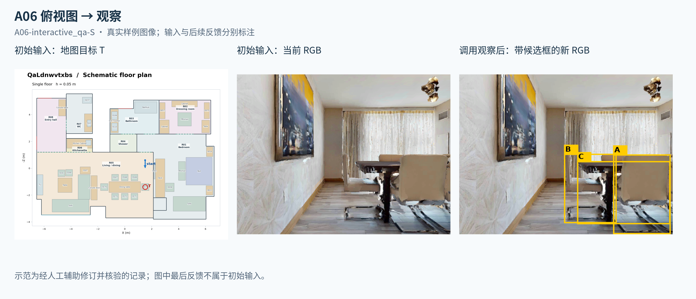
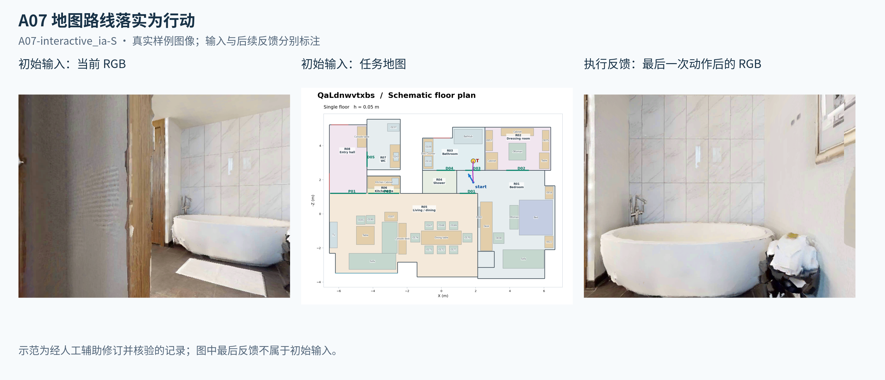
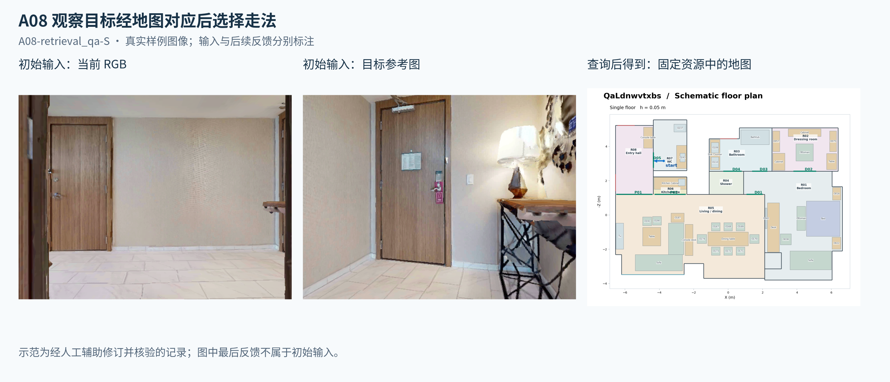

# 原子空间任务图册

更新：2026-10-14。本文件夹展示原子任务的输入、输出和实际样例；插图采用相对路径，可整体复制或分享。任务 SVG 与 PNG 同名保存在 `images/`。

## 训练任务设计

围绕定位、局部规划、动作控制、观察→地图、地图→观察五项能力，在一个房间或相邻区域完成一次判断或运动事件；当前主要训练已有空间记忆的使用，不涉及长程探索与在线建图。

四种形式：**简单 QA** 一次给齐证据后回答；**查询 QA** 查阅固定资料后回答；**交互 QA** 主动观察／短移动后回答；**交互 IA** 实际完成局部事件。读取旧全景是查询，采集新全景是交互；IA 不以完整导航的 STOP 判据结束。

现有每个任务与形式组合各有单帧和六视角全景版本。以下 A01–A08 是真实展示样例，A09 是待构建设计。图中查询结果、执行反馈和正文答案用于展示，不属于初始输入。

### A01 自身定位与定向

**输入：**当前单帧／全景＋候选位姿地图。**输出：**自身位置与朝向；交互版可补充观察。形式：简单 QA、交互 QA。

**例子：**“A/B/C 哪个位姿与观察一致？”答案 **C**：从卧室侧通道看到浴缸，不等于已经在浴室。不给当前位置真值箭头；交互版仍回答指定的初始位姿。

样例：`A01-simple_qa-S`。

### A02 短程位姿更新

**输入：**原始起点＋真实短动作和前后观察。**输出：**执行后的位置与朝向。形式：简单 QA。

**例子：**“前进两步，再右转一次，末状态对应哪个候选？”答案 **A**；本例前进约 0.5m，右转 30°，起点提示已知，末位姿须推断。

样例：`A02-simple_qa-S`。

### A09 俯视图与观察联合空间问答（待构建）

**输入：**地图＋当前单帧／全景＋空间问题及明确的定位辅助条件。**输出：**物体／房间相对自身的方向，或出口与局部走法。形式：简单 QA、查询 QA。

**例子：**“床在我的哪个方向？”“浴室在我哪边？”“怎样离开当前房间？”下图复用 A07 素材，进入浴室的回答示意为：“D03 在前方略偏右，先右转对准门口，再前进穿过，进入 R03。”

**这不是已采集、核验的新样例。** 正式出题应移除图中原 A07 的紫色路线和终点 T，避免泄漏走法。方向绑定题目时刻的朝向；房间方向与门口方向分别表达，有多个可用出口时接受合理答案。

### A03 局部子目标与通路选择

**输入：**当前观察＋起点提示＋相邻目标区域＋地图或可查询资料。**输出：**下一处应经过的开口。形式：简单 QA、查询 QA。

**例子：**“进入 R03，到 T 所在的门内侧，应经过哪个开口？”查阅资源索引和地图后回答 **D03**；此题选择通路，不要求实际穿门。

样例：`A03-retrieval_qa-S`。

### A04 局部动作选择与执行

**输入：**当前观察＋已指定的局部通行目标。**输出：**下一动作，或实际转向、前进完成通行。形式：简单 QA、交互 IA。

**例子：**“对齐 D01 门口，穿过它，到 T 附近。”真实执行 **右转一次→前进两步→接收新观察→再前进两步** 并穿门。通路已经指定，重点是落实动作。

样例：`A04-interactive_ia-S`。

### A05 观察→俯视图

**输入：**观察中指定的物体＋地图候选。**输出：**对应的地图实例。形式：简单 QA、查询 QA。

**例子：**“RGB 黄色框 T 对应地图 A、B 还是 C？”答案 **C**：目标是床脚长凳，结合与床的关系确定对应。

样例：`A05-simple_qa-S`。

### A06 俯视图→观察

**输入：**地图指定物体＋当前观察。**输出：**对应的画面实例；交互版可取得新观察。形式：简单 QA、交互 QA。

**例子：**“地图红圈 T 对应哪个候选物体？”调用 `nav_observe` 后回答 **B**，即餐桌端部的椅子。候选框由原子样本工具附加，生产 Harness 不默认提供检测框，也不据此宣称无提示检测能力。

样例：`A06-interactive_qa-S`。

### A07 地图目标／路线落实为行动

**输入：**地图短路线＋起始朝向＋当前观察。**输出：**将路线对应到眼前环境并实际执行。形式：交互 IA。

**例子：**“沿紫色路线，通过沿途开口，到 T 附近。”本例右转对齐后前进，通过 **D03**；核验真实经过指定开口并到达局部范围。

样例：`A07-interactive_ia-S`。

### A08 观察目标落图后选择走法

**输入：**目标参考图＋当前观察＋可用地图。**输出：**目标区域对应与通路选择，或实际进入区域。形式：查询 QA、交互 IA。

**例子：**“参考图是哪片区域，过去应经过哪个开口？”凭入户门、玄关桌和台灯确定 **R08 玄关**，查询地图后回答 **D05**；参考图朝向可以不同于当前朝向。

样例：`A08-retrieval_qa-S`。

## 数据说明

已有 **28 条样例、58 条逐决策记录**，覆盖 A01–A08 八簇和四形式；六条 IA 均真实执行并独立重放，A09 未计入。

来源为 **25 条 Agent 辅助构造、3 条混合修订**，保留原始失败与修订；这些数据展示可行的数据形态，不代表教师自动生成稳定或训练有效。部分交互题初始信息已足够，尚不能证明主动获取新证据必要。

完整交互与 JSONL 位于项目 `data/atomic_spatial/demo-20261012-v1/`；本图册仅包含可独立分享的正文、图片和图源。
