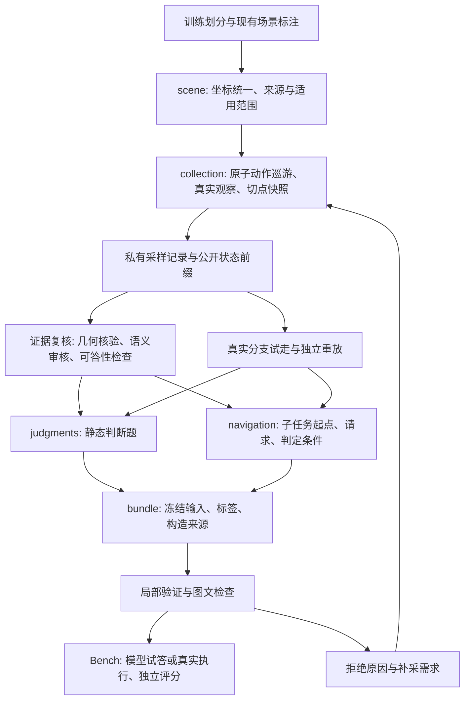

# 首批任务构造器

本模块把训练场景中的真实观察与执行，构造成冻结的空间判断题和导航子任务。
目标范围是 `docs/develop/Task_synth.md` 的 37 类判断题与 12 族子任务；目录覆盖、
实际产出、标签验证和可用于训练是不同状态，必须分别报告。

## 架构与数据流



- `sampling/scene.py` 读取现有地图格式。它验证坐标与引用，提供私有房间、开口和物体几何，
  不把已有地图的完成标记当作新样本的视觉验收。
- `sampling/collection.py` 复用 `NavigationExecutor` 采样。主路径只使用节点记忆与原子动作；
  额外采集的深度和相机几何保存在私有目录。最短路用于提出路线，通行结论以真实执行为准。
- `sampling/geometry.py` 负责投影、深度一致性和有限开口线段等可独立验证的计算。
- `sampling/semantics.py` 在已保存位姿渲染私有实例掩码，先核对 RGB，再检查实例关联和标注范围。
  像素为零只有在该实例的映射完整性有明确证据时才表示未见，否则保持未知。
- 已审核表面点可通过真实深度和实例掩码投到其他已观察视图，保存为 `derived_sightings`。
  这一步仅使用现有缓存，不渲染或调用模型；审核与构造入口重新核验来源，不把派生行冒充新的语义审核。
- `review/evidence.py` 统一保存绑定 RGB、像素和源标注哈希的审核；`review/memory.py`
  从已审核的节点局部观察生成描述和房间别名，另存快照，原始快照保留。
- `catalog.py` 保存题型目录；`judgment/construction.py` 和 `navigation/construction.py` 按实际证据构造样本。
  缺少条件时留下拒绝记录，不能用默认值补出答案。
- `bundle.py` 冻结公开输入与私有标签。采样、语义复核、派生与评分分别保留来源。
- `judgment/scoring.py` 与 `navigation/scoring.py` 独立评分。前者核对有类型、单位和
  容差的答案，后者读取真实动作与结束状态。模型自述、工具 reached 或存在描述文字均不
  单独构成任务成功。
- `src/bench/tasks_subset.py` 只消费冻结任务。判断题使用固定证据，导航子任务使用现有
  `HarnessSession`；评测时不修改输入、补标或重新生成任务。

Python 的 Dataset 管理离线采样、修订和冻结；Environment 管理仿真；Bench 消费冻结任务。
模型请求复用现有 TS Core，导航执行复用 HarnessSession，没有另建模型循环、工具 schema 或压缩协议。
哪些分支已取得合格实例，以检查产物为准。

## 状态与标签

一个切点由实际位姿、节点记忆、已获得的观察和轨迹前缀组成。原始帧使用带采集流名称的
引用，防止恢复快照后的相同 `f_0001` 被误认为同一张图。所有历史判断只使用该切点前缀。

公开节点地图保持空白底图。房间多边形、物体几何、完整连接图、未来试走图像和评分条件
不进入模型工作空间。问题需要的目标图与公开阈值必须显式提供，不能依靠模型猜私有定义。

同一份不可变切点可供多种题型使用。错误记忆任务复制一份切点后注入可核验的错误，保留
原始状态与改动来源。复核后的语义只能写入有当前公开证据支持的记录。

每个集合的 `private/*bundle.json` 记录场景、帧、切点、试走和目标。切点的 `frame_keys`
定义可见历史，`node_frames` 关联已存节点，`snapshot` 可恢复工具状态。帧引用包含采集流名称；
同一步、同一身体位姿后来拍摄的全景，也不能补入更早的切点。

冻结目录 `cases/<id>/` 包含 `task.json`、`public/` RGB、`private/label.json` 和
`construction.json`。任务保存快照、标签、episode/environment 和图片的摘要。
Bench 在启动前核对摘要，结束后再次检查输入未变；不匹配归为软件/产物故障，不给任务评分。
标签和构造来源用于离线检查，均不传入模型。

试走轨迹与目标区域分别保存：参考路线的任意一点不等于可接受的终点。试走后的帧属于
私有分支，不能被拷入预测题或子任务的初始观察。参考调用还要在独立环境恢复并重放；
它证明参考执行可复现，不证明题目语义正确，也不是教师示范。

## 对原方案的调整

- 探索判断依据已见、尚未穿过的开口及明确的公开选择条件，接受等价选择；不用隐藏目标
  所在房间指定唯一正确出口。
- 房间关系和路线判断只使用公开历史支持的连接；“到过另一侧房间”不等于穿过指定门。
- 示意物体框只用于寻找候选像素。深度一致性、实例对应和视觉语义分别检查，不能仅因
  物体中心在视野内就判为看见。
- 地面标记检查周围像素的地面支持率，拒绝车轮辐条等细缝后面的孤立地面射线；实际图片
  复核仍然保留，真实导航重放通过并不保证标记清楚。
- 地面标定测量实际深度片区的高度和法向，不把示意地图的楼层高度当成精确表面高度。
  小竖面即使落在地面高度容差内也不能通过；采样与题目构造复用同一判定。
- 开口中心是空中位置，投到 RGB 后可能落在更远的墙、柜或关闭门上。物理开口使用带来源绑定的
  纵向轮廓，经图像审核确认指向同一个可见入口；审核和正式题面使用同一轮廓与名称。
  `open_functional_connection` 仅记作带明确边界 ID 的区域转移，不计为物理开口。
- 房间图只使用节点中已公开命名的房间。路线题提供观察时刻、公开拍摄位姿和完整历史轨迹，
  按真实顺序展示相关动作帧；不从缺少时间顺序的灰线地图断言某扇门从未穿过。
- 俯视布局只要求公开观察支持的部分。记忆文字可以保存多个历史视角支持的累积知识，
  不强制等于当前默认全景的逐图说明。
- 指令子任务缺少可靠句级对齐时，使用明确记录的短完整官方指令变体或拒绝该候选，
  不按路径长度凭空切出一句话的终点。
- 模型试答用于发现可答性与接口问题；答对不自动证明标签正确，答错也不自动证明题目无效。
- 私有深度只用于计算与核验。米制距离采用公开标定的地面点，米制布局采用带公开位姿和
  相机参数的多视角证据。运动估计不公开待预测的位姿；非零位移样本的容差不能让零位移通过。
- 已知房间之间的路线必须由历史真实穿越支持。开放分区的越界另记为 `zone_transitions`，
  不冒充穿门；缺少观察、实例映射或完整性声明时不生成确定的否定标签。

## 分模块验证

开发与运行统一使用现有 `vln` 环境，仿真只使用物理 GPU 0、1。配置与启动入口组合现有
模型、运行时和场景配置，不在代码中保存密钥。

1. 先验证坐标转换、相机投影、遮挡、楼层和房间边界、有限门段穿越。
2. 用小规模真实采样检查切点、图片引用、历史前缀与分支隔离。
3. 保存采样结果，逐类检查构造与拒绝条件、答案格式、正负例和标签分布。
4. 对评分器加入反例：停在起点、走过错误门、碰撞但仍移动、立即结束、只填描述、预算耗尽。
5. 打开实际图文样本，必要时调用不同模型复核；保留不确定与被拒绝的候选。
6. 模块通过后，再运行少量端到端模型试答与导航，检查真实请求和回执。

不因所有 JSON 可读、测试通过或一次模型成功就宣称数据适合训练。

## 分阶段命令

从仓库根目录运行。这里仅选择一个场景，配置可包含多场景。以下命令使用同一集合目录：

```bash
CONFIG=config/tasks/tasks_subset.yaml
OUTPUT=cache/tasks_subset/single-scene
SCENE=hm3d/train/00612-GsQBY83r3hb/GsQBY83r3hb.basis.glb

subset() {
  conda run --no-capture-output -n vln python -m src.dataset.tasks_subset \
    --config "$CONFIG" --output "$OUTPUT" --scene "$SCENE" "$@"
}
subset --phase collect --gpu 0
subset --phase review --bundle private/bundle.json
subset --phase enrich --bundle private/reviewed_bundle.json
subset --phase trials --bundle private/enriched_bundle.json --gpu 0 --trial nav_02
subset --phase build --bundle private/enriched_bundle.json
subset --phase check --bundle private/built_bundle.json
```

| 阶段 | 输入与产物 | 执行条件 |
|---|---|---|
| collect | 真实观察与原始切点，保存为 `private/bundle.json` | Habitat，物理 GPU 0 或 1 |
| review | 在 `private/review_candidates.json` 保存带哈希的候选；把审核增量追加到 `private/reviews.jsonl`，另存 `private/reviewed_bundle.json` | 无仿真；只在配置了模型且未指定导入时调用模型 |
| semantics | 从指定包和已有观察生成 `private/instance_bundle.json`、私有掩码及绑定证据 | 当前支持 HM3D；新增帧用 GPU，已有合格帧仅核验缓存 |
| endpoints | 导出 `private/size_candidates.json`，可调用模型选择可见物理边缘的两个端点；验证后另存 `private/size_bundle.json` | 无仿真；默认只导出，有 `review.models` 才选择像素 |
| reference | 为 `--object` 指定实例独立渲染目标参考，另存 `private/reference_bundle.json` | Habitat；参考不加入巡游前缀，仍需绑定 RGB 的实例审核 |
| enrich | 从显式审核包生成 `states_enriched/` 和 `private/enriched_bundle.json` | 无模型、无 GPU |
| trials | 从指定包的切点重放；将试走结果写回指定包。可重复指定 `--trial` 限定种类 | Habitat，物理 GPU 0 或 1 |
| build | 从指定包冻结 `cases/`，新增目标和隔离切点另存 `private/built_bundle.json` | 无模型、无 GPU |
| check | 核验冻结样本，输出 `check.json` 和 `index.html` | 无模型、无 GPU |

审核默认仅导出候选。配置 `review.models` 为模型配置路径列表，例如
`[config/models/qwen27.yaml, config/models/sol.yaml]`，再运行 review 即可对默认前三条候选调用模型。
可用 `--candidate ID` 精选候选，或用 `--import-reviews 路径.jsonl` 导入已有审核且不调用模型。
同一真实模型 ID 对同一候选只记一次，推理档位单独记录。服务异常、输出预算耗尽和语义不确定分别留存；
前两者不是语义投票，真实的不确定或相互矛盾的有效审核仍阻止通过。
相对 `--bundle` 以各场景集合为根；绝对路径只允许选一个场景。

上述命令演示一条最小路径，语义审核为空时会留下拒绝记录，不保证产出所有题型。
后续审核可以消费 `instance_bundle.json`、`enriched_bundle.json` 或含试走的新包；审核输入与
`reviewed_bundle.json` 输出不能是同一个文件。目标身份、可答性和记忆纠错审核依赖前面阶段，
应按候选与拒绝原因推进，不盲目重复所有请求。

实例证据用 `--phase semantics --bundle private/reviewed_bundle.json --frame <key>` 开始；
后续显式选择 `private/instance_bundle.json` 可以扩展帧或重新应用 `private/instance_bindings.json`。
完整性绑定包含实例 ID、源文件和证据帧摘要、覆盖的实体部位、审核者与方法。没有绑定时保留未知，
不能自动填入“全部完整”。实例掩码始终私有。
当前 `target_seen_nodes` 的确定标签来自这条 HM3D 实例证据路径；可答性另行检查，
不再由模型对各节点的投票直接决定真值。导航缺席审核覆盖切点的所有相关历史帧。

尺寸比较先运行 `--phase endpoints --bundle private/instance_bundle.json`。可在
`endpoints.pairs` 指定 `{object, frames: [第一视图, 第二视图], axis, part_description}`，
或从导出的候选中用 `--candidate` 选择。模型只选像素；程序检查两端属于同一原生实例、
处于同一水平面、第二视角深度一致，并能从公开相机参数和位姿重建。之后对 `size_bundle.json`
运行 `review`，由两个独立审核者确认实体部位、完整边界和轴定义。几何通过不代替完整范围审核。

记忆补写会使旧试走失效，必须从新快照重新 `trials`。冻结已有 cases/built 包时拒绝覆盖；
修订应使用新的集合目录并保留原集合及失效原因。`prepare` 仅执行目标相关试走；
`all` 是 collect/trials/build 的便捷组合，不包括语义审核和最终验收。
各场景 `manifest.json` 保存阶段输入输出路径与摘要，顶层索引保留其他已运行场景。

固定样本模型试答或导航使用同一入口：

```bash
conda run --no-capture-output -n vln python -m src.bench.tasks_subset \
  --task <集合目录>/cases/<id>/task.json --config config/models/sol.yaml \
  --output cache/tasks_subset/model-attempt --gpu 1 --reasoning-effort high
```

判断题只有公开 RGB、问题和输出 schema，工具关闭；导航题恢复节点记忆快照并使用原子动作。
结果区分软件/服务异常、预算耗尽、格式错误、任务失败和成功。真实 HTTP 请求、回执和用量
保存在运行目录，用于核对实际工具与 reasoning effort。

nav04 的新节点文字与房间语义由实际执行全景离线审核，保存在 `private/execution-review/`。
运行 `python -m src.dataset.tasks_subset.review.execution --run <运行目录>
--review-model config/models/qwen27.yaml --review-model config/models/sol.yaml`，
得到独立的 `final_assessment.json`，原始执行结果保留。已知房间别名按程序比对；
新房间可以使用新别名，带有“卧室”等类型含义的名称另需图像支持。双审都接受才能通过。

## 构造条件与当前边界

目录中的每个类型都有构造入口，以下列出上游来源；缺少来源时记录拒绝，不用字段占位符出题。

| 判断题组 | 构造所需证据 |
|---|---|
| 相对位置、换参考系、距离、远近比较 | 当前真实 RGB 标记、深度核验；米制标签另需公开标定与地面约束 |
| 自我中心布局、可见俯视布局 | 完整同位姿六视图；米制布局另需有已知基线的同点多视角 |
| 跨视角身份、相对相机位姿、全景关系、相机运动 | 共视实例/点、真实相机姿态；身份审核与运动几何分开核验 |
| 可走距离、开口通行、直接到节点、选动作、碰撞 | 从冻结切点真实试走、独立重放、对起点画面的可答性审核 |
| 开口类型、当前房间 | 对 RGB 的类型/房间匹配审核，房间别名来自已有节点 |
| 出口方向、出口去向、房间相邻、房间路线、未走出口 | 前缀观察与实际有限门段穿越，未知去向保留 unknown |
| 最近节点、曾到过的位置 | 公开锚点、尺度和执行轨迹；“以前”使用显式时间范围 |
| 画面到地图、记忆布局、物体关系、最近地标 | 节点全景与公开拍摄位姿，米制目标另需公开可恢复的几何 |
| 已观察的动作后果、受阻回执 | 连续前后帧及真实碰撞/移动回执 |
| 目标身份、见过目标的节点、是否到达 | 实例参考与关联；完整节点覆盖；公开到达阈值与可答性审核 |
| 目的地出口、节点开口路线、探索出口 | 已观察的连接图，等价路线均接受；探索不使用隐藏目标位置 |
| 记忆矛盾 | 隔离副本的一处错误、公开可核对的反证、原始记录与修订来源 |

远近比较包括距离变体，以及可见物体指定部位的水平宽度／长度比较；后者须经过端点几何与完整范围双审。
具体变体是否已有通过实例以产物检查为准；受阻恢复先实现下述安全点变体。
同类中的难度、正负例和方向分布必须从实际产物统计，构造器存在不代表已有均衡数据。

HM3D 使用 ObjectNav 和 GOAT 的训练场景交集；MP3D 使用 R2R 训练场景，短完整官方指令保留原始目标。
HSSD 加载完整 `scene_instance` 和资产数据集配置，检查官方训练划分并排除与验证集共享建筑编号的变体。
HSSD 的起点从实际 NavMesh 采样，episode 仅作 `program_assisted` 巡游载体。现有 HSSD 墙体图可支持几何候选；
缺房间和物体标注时，相应题型记录前置条件不足，官方指令题也不使用这类载体。

nav03 的 `safe_waypoint` 变体从真实受阻切点开始，公开最后一次移动的受阻回执和已走过的安全点 P1 的地图 UV。参考路线独立重放；评分要求恢复有效移动并到达 P1。这一变体验证简单恢复。

| 导航族 | 候选与验收 |
|---|---|
| 01 / 14 | 当前可见地面点、真实接近；测地距离到达。14 记录记忆查询，不把少查询解释成能力因果 |
| 02 | 当前开口、实际穿越有限门段，最终处于另一侧房间 |
| 03 | 真实受阻、已走过的安全点、有效移动并到达 |
| 04 | 未建节点的位置、新全景、创建节点；描述语义保留 needs_review，非空文本不算成功 |
| 05 | 圈选目标的接近提交；另有相同指令的实例匹配正负配对，异实例必须到场并明确拒绝 |
| 07 | 仅一个已索引节点见过，其他节点及当前视图明确未见；返回目标接近区域 |
| 09 | 目标在起点节点中见过、已有至少两段房间路线；到达目标，不限制唯一参考路线 |
| 10 | 全部起点前缀明确未见目标、目标房间未访问；真实探索并到达 |
| 12 | 可公开核对的单字段错误副本；在节点附近取得新全景，再提交对应字段修正并到达目标 |
| 16 / 18 | 短官方训练任务、真实原子执行和提交，依项目官方目标评分 |

实例目标使用物体足迹周围同房间、同楼层的可达接近区域；参考路线只选其中一点。
整个轨迹不能当成目标区域，隔墙的欧氏接近也不能当成到达。
自建物体导航请求公开说明距离足迹的接近阈值，匹配后提交和错配后拒绝都先满足该条件；
目标位置与私有区域坐标仍不进入题面。判断题的到达可答性另行审核，不能从仿真知道目标区域
就推断 RGB 足以判断被遮住的物体足迹。

nav18 从训练集选用短官方请求：HM3D 默认 ObjectNav，MP3D 默认 R2R；可按场景在
`collection.episode_source` 指定 GOAT 或 RxR。GOAT 每例只保留一个导航请求，
私有记录其原始目标索引；图片目标只公开 RGB。参考路线在全部官方目标位置中选择最近的
可达位置，按本项目 `score_goal` 的官方距离阈值验收。这一步复用官方数据与项目评分，
不代表完整复现官方评测协议。R2R/RxR 的短完整指令也可构造 nav16。

`check.json` 分开报告 constructor_registered、produced、structural、physical、visual、
model_tried、training_ready；HTML 供检查者浏览，含私有答案，不能作为模型输入。
最终样本验收文件为 `cases/<id>/private/review.json`：需要绑定 task/label/snapshot 摘要、
审核者，以及 visual/label/public_evidence 三项实际核验结果。结构或物理通过不能自动生成该验收。
未完成的条件明确留在报告里，已失效样本通过 invalidations/supersedes 关联原产物。
training_ready 在此表示单个任务记录的输入与标签已验收；教师轨迹、整个集合的分布与训练效果
仍须分别验证。

目前有 HM3D、MP3D、HSSD 的真实采样与部分代表题型验证；GOAT/RxR 阅读器接入尚需真实验证。
本模块交付构造、审核、冻结与评测流程；完整语料规模、全题型真实覆盖及训练效果不由目录注册数推断。
