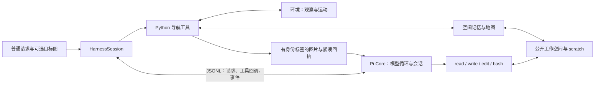

# 导航 Harness：实现与接口

Python 持有环境、公开观察和空间记忆，Pi Core 持有唯一的模型会话。模型通过所选记忆模式的工具与原生文件工具自主组织观察、检索、记忆维护和运动；程序不规定固定的导航阶段。

## 记忆模式

会话创建时通过 `memory_type: entity / node` 选择，默认 `entity`。配置片段位于 `config/memory/`，与模型、basic/super、预算配置组合。实体模式保留原墙图、八工具和 `memory/entities.json`；下文既有实体接口描述仍适用于该模式。

节点模式使用空白底图与 `memory/nodes.json`，只暴露 `observe / move / memory_read / memory_edit / task_read / submit`。它与实体模式共用观察、运动、读图、地图渲染、Pi 会话及压缩，未创建第二套 Harness。模式写入运行结果和快照，跨模式恢复会报错；节点模式无需已构建墙图。

每个节点存 `id / anchor / panorama / room / description / history`：位置取首次全景的真实拍摄位置，摘要独立于图片，历史只存全景引用。节点位置不是画面中物体的位置。`create` 自动分配 ID，模型提供摘要及可选房间；`update(refresh=true)` 在距固定锚点 1 米内更新默认全景，保留摘要；纯文字与分组可远程修订；`merge` 要求综合摘要并合并历史引用，`delete` 不删除原始观察。

`memory/nodes.json` 在同一个原子快照中保存 `{"nodes":[节点记录],"rooms":{"living_room_1":"房间整体描述"}}`。房间描述由模型独立维护，记录整体布局、主要物体、空间关系和核实过的出口；节点描述关注各观察位置。房间关联的节点从 `node.room` 实时计算，证据沿用节点全景，不另存成员列表或图片。尚未撰写房间描述时，查询返回 `description:null`，不自动拼接节点摘要。

创建或刷新之前必须取得当前完整全景，可以直接使用 `move(after=panorama)` 的结果。编辑不隐式拍图；移动后不得把旧图绑定到新位置。示例：

```json
{"operations":[{"op":"create","room":"living_room_1","description":"Sofa facing a TV; a bookshelf beside the dining entrance."}]}
{"operations":[{"op":"update","id":"N001","refresh":true}]}
{"operations":[{"op":"update","room":"living_room_1","description":"Sofa faces the TV; the dining entrance is beside the bookshelf."}]}
```

不带 `id` 的房间更新替换整体描述（最多 1000 字符），`description:null` 清除描述而不改节点归属；它无需新观察，可与节点编辑同批提交。房间名必须已有节点引用或已有描述。节点重新分组、合并、删除后，房间成员自动变化；已有房间描述保留，模型根据新证据修订。

当前节点快照使用上述对象格式；此前仅保存节点数组的实验原件保留，不直接作为当前格式恢复。

节点模式读工具按目的分三支：

| 读取 | 示例 | 回执 |
|---|---|---|
| 文本索引 | `{"mode":"text","query":"TV"}` | 节点摘要、位置和全景引用，不自动附图。单 `id` 读取详情，历史可分页。 |
| 房间目录／详情 | `{"mode":"text","source":"rooms"}`，可加 `room` 或 `query` | 分页返回房间名、整体描述及节点 ID。`source:nodes` 按 `room` 查节点时也附房间描述。 |
| 历史图片 | `{"mode":"image","refs":["N001"]}` | 返回 `node`、实际显示 `image`、全景 `group`、图片拍摄 `pose` 与固定 `anchor_pose`；裁剪使用新图片 ID。也可直接打开 `p_ / f_ / i_ / m_`。 |
| 节点地图 | `{"mode":"map","view":"ego","radius_m":6}` | 空白底图、节点与实际微步轨迹；`node_index` 包含全部可见 ID＋房间，`records` 最多 5 条详细描述，优先高亮再取附近节点。 |
| 按房间高亮 | `{"mode":"map","room":"living_room_1"}` | 默认展示已探索范围，高亮该房间全部节点并附整体描述；可叠加 `highlight`，显式 `local/ego` 则仍按裁剪范围显示。 |

`mode:text, source:observations` 可以分页发现未挂节点的途中观察；全景六张图算一个事件，目标/问题图不会混入场景历史。历史图片的拍摄位姿和朝向不因节点刷新而改变。`p_` 是全景索引，读取后实际显示图统一返回对应 `i_`，与裁剪后的 `i_` 一样按显示尺寸选点；拼图内标为 `detail: f_` 的 ID 只用于单独打开原帧，不能配拼图坐标。

节点坐标复用原换算公式，但标定从起点生成：初始 `[0.5,0.5]`、每坐标单位 20 米，墙线为空；超出初始 `[0,1]` 时扩展显示范围，不重新标定。房间只着色分组，不生成房间边界或相邻节点之间的虚构路线。super 下的 `target:{node:N001}` 按普通地图坐标直行，不自动授予 NavMesh 规划资格；RGB 选点仍使用原有几何辅助。节点运动回执保留 `target_node`；直行受阻提示选择中间可见路标，动作上限提示检查终点后继续。不会将局部受阻解释为目标不可达。

运行 `bash scripts/run_node_goat.sh` 可用 221 Sol high、super 档跑一个现有 GOAT 连续多目标 episode。`python -m src.bench run/pilot` 支持两种模式；旧自建 sequence 含实体记忆评分，仅支持 entity，避免把两种不同含义的记忆混合评分。

这两种配置也改变墙图和读工具条件，因此对比结果是完整模式的对比，不是纯存储格式消融。节点模式的压缩快照只带有限摘要和查询入口，原始图片与自由笔记仍在文件中。

## 从请求到下一次决策



1. `open_session(...)` 接收已经初始化的环境、公开墙图和可选状态快照，准备工作空间与初始 RGB。工具定义在会话创建时固定。
2. `prompt(text, images, limits)` 追加用户请求、当前画面与地图位姿。可选目标图保留到下一条新请求替换它；同一会话保留环境位置、历史、记忆和文件。
3. Pi 串行执行工具。Python 工具返回 JSON、带身份标签的图片以及内部公开状态快照；原生 Coding 工具直接在受限工作空间执行。回执追加到同一历史。
4. `submit` 结束当前请求，返回确认而不返回评分；普通文字结束只交还控制权。两者都不关闭会话。`close()` 才释放 Core，环境生命周期由创建它的调用方管理。

`ask(...)` 保留导航请求与目标图，只允许查询已有证据和提交答案；Coding 工具仍可在 `scratch/` 计算。`continue_run(...)` 从已有历史继续，不插入新的用户消息。`snapshot(path)` 在空闲边界保存环境状态、工作空间、观察索引、私有投影资料与 Pi 会话，恢复时不重新拍摄当前帧。

执行结果是 `PromptResult`：`submitted / answer / reason / requests / actions / elapsed_seconds / record`。预算限制和故障归档属于运行控制，不进入工具的公开评分反馈。工具参数定义只有一份：[specs.py](tools/specs.py)；执行在 [runtime.py](tools/runtime.py)，会话管理在 [session.py](session.py)。

## 共享坐标与引用

墙图输入为 `scene/map.json`：`origin:[X,Z]`、`size_m`、`floor_height`、`walls`。墙线存 Habitat 的水平米坐标；实体存全局归一化 UV。转换统一使用 [coordinates.py](../common/coordinates.py)：

```text
u = (X - origin[0]) / size_m
v = (Z - origin[1]) / size_m
heading = 0° 朝 -Z（固定地图上方），右转为正
pose = {"pos":[u,v], "heading":角度}
```

公开位姿的 UV 保留四位小数，朝向保留两位。地图裁剪和旋转只改变显示，不改变实体坐标；`view={"ego":6}` 表示半径 6 米、当前身体朝上。`full` 根据墙线包围盒显示，四周最多留 1 米边距。

身体四元数到朝向、相对方位/距离及反向定位均使用公共坐标函数；RGB-D 查询依据采集时的身体方向，不能用当前方向重解释旧图。绘图先确定全局 UV 到像素的矩阵，再计算其逆并随图片保存为 `pixel_to_uv`；地图选点读取该逆矩阵，裁剪或旋转不会重新定义 UV。RGB-D 的相机投影保留在 `geometry.py`，其世界点再进入同一世界/UV 转换。

工具共用三种位置引用：

| 引用 | 例子 | 解释 |
|---|---|---|
| 实体 | `{"entity":"O01"}` | 读取当前实体的已记录位置 |
| 图片点 | `{"image":"i_0003","pixel":[320,240]}` | 在该张实际显示图片上的零起点像素 |
| 地图点 | `{"uv":[0.42,0.58]}` | 全局地图 UV，范围 `[0,1]` |

`f_` 是原始观察或目标图，`m_` 是地图视图，`i_` 是裁剪或拼图。派生图记录来源及像素变换，选点可递归回到原帧或原地图；拼图标题和留白不能选点。地图图像可以直接回到 UV；RGB 需要 super 档的私有深度。目标参考图没有深度，不能用于 RGB 反投影。

观察、移动及重开图片的回执包含实际图片的 `size:[width,height]`；`task_read` 的参考图也返回 ID 与尺寸。`pixel:[x,y]` 必须对应所选 ID 的图片，不能把整张全景的像素传给其中的原帧。越界错误给出图片 ID、尺寸和合法范围，不自动截断坐标；例如 `pixel_out_of_bounds: image=f_0001; size=640x480; valid x:[0,640), y:[0,480)`。

## 八个工具与固定搭配

回执以 JSON 为主，图片前标注 `CURRENT / HISTORY / MAP / TARGET / QUESTION`，重新打开的派生图标为 `VIEW`。下表输入均为实际可调用参数；示例中的 ID 须已经存在。

| 工具与设计目的 | 输入例子 | 输出与自动附带内容 |
|---|---|---|
| `observe`：取得新的视觉证据 | `{"mode":"panorama","project":true}` | 全景 `image/size/group/views[{frame,yaw,size}]/step/pose` 和一张六视图拼图；`project:true` 在 super 档再附局部 RGB 投影地图。默认 `mode:current` 返回 `frame/size/step/pose` 和当前单图。 |
| `move`：执行运动并看结果 | `{"mode":"steps","actions":["turn_right","move_forward"],"after":"panorama"}` | `done/stop/frame/size/step/pose`，有碰撞或受阻时加 `events`；默认附动作终点 RGB，`after:panorama` 附终点全景并报告观察是否执行。 |
| `map_view`：将空间判断放到同一张图上 | `{"view":{"ego":6},"highlight":["D01"],"project":{"source":"f_0012","points":[[320,240]]}}` | `view_id/map/bounds/image_size/warnings/records` 加地图；`records` 最多 12 条，优先对应显式高亮，否则取图内实体。投影点加 `source/points`，紫色 `P1…` 仅为临时标记。 |
| `view_images`：查已有证据，保留选点依据 | `{"images":[{"image":"f_0012","crop":[0.2,0.1,0.8,0.9]}],"layout":"separate"}` | `images` 列返回图 ID、可用的帧/位姿信息或派生图尺寸，附图片；裁剪/拼图得到新 `i_`，原图保留。无新观察、无移动。 |
| `memory_read`：从地图简表展开具体记录 | `{"ids":["D01","O01"]}` | 完整实体，证据转为 `{frame,step,pose,...}`；默认附最多两张不同帧的证据图，列 `attached_evidence`。查询匹配总数不超过 5 也返回详情，否则分页简表。 |
| `memory_edit`：一次完成记录修改与位置解析 | `{"operations":[{"op":"update","id":"O01","fields":{"location":{"image":"f_0012","pixel":[320,240]}}}]}` | `changes` 与改后实体的坐标、关系、证据字段；删除项只在 `changes` 中出现。写入位置时附一张源图选点＋保存后地图点的合图。像素来源证据自动加入，更新位置时保留未显式替换的旧证据。 |
| `task_read`：核对当前任务 | `{}` | 当前 `request` 和目标图；QA 时另含 `question` 和问题图。图片标注角色、帧 ID 和尺寸。不返回历史目标、评分或隐藏位置，不采集新观察。 |
| `submit`：明确交还当前请求 | `{}` 或 `{"answer":"O01"}` | 仅 `{"submitted":true}`；后续同批调用不再执行。没有成功/失败判定。 |

补充参数保持在各工具内：

- `observe` 全景的六个 `yaw` 为 0/60/120/180/240/300°，相对采集开始时的身体，右正；采集结束恢复身体与相机状态。查看其中一张图不会转动身体。
- `map_view.view` 还支持 `explored`、`full`、`{"around":[ID]}`、`{"around_self":米}`；`labels` 为 `id/name/both/none`。super 的 `overlay:[f_...]` 把最多六张已有观察投影到地图，不修改正式记忆。公开回执省略仿射矩阵，原变换保存在视图索引。
- `view_images.images` 最多六项，`crop` 是该来源图的归一化 `[left,top,right,bottom]`；`layout:grid` 拼成一张图。
- `memory_read` 用 `ids` 或 `filter:{type,room,category,located}`，`limit` 默认 30、最大 300，`offset` 默认 0；super 支持 `near:{self:米}` 或 `{entity:ID,radius:米}`，附相对当前身体的方位和距离。未附的证据图仍可按帧号打开。
- `memory_edit` 的合图最多包含两张源图和一张局部地图，尺寸最多 960×520；直接写 UV 或合并继承位置时可只有地图。合图有独立 `i_`，可重新打开或选点；其标记表示模型选择与已保存位置，不表示识别正确。只改文字、删除或清空位置不附图；绘图失败时明确返回“记忆已保存”，避免误重试写入。

### 运动边界

`move(mode:steps)` 每次接受 1–6 个前后左右平移或左右转向动作。平移名义距离 0.25 米，转向 30°；执行层以微步滑移并适度自动转向，单原子动作自动偏航不超过 15°。有进展的碰撞可继续，受阻中断；实际微步路程用于运行限制，批量调用不能绕过动作预算。

super 另提供 `mode:face/approach`，共用 `target` 引用和 `max_actions:1…40`（默认 40，包括转向）。`face` 返回 `bearing_after`；`approach` 返回 `reached/remaining/planner`，可给 `stop_distance`。所选点离地不超过 0.15 米时默认停距 0.2 米，否则为 0.6 米。

`goto_planner:local` 仅对保有真实观察来源的位置使用局部 NavMesh：目标、路径及活动范围不超过 8 米，路径相对起点高度变化不超过 0.5 米。任意 UV 或无观察来源的记录走 `straight`；`goto_planner:straight` 可统一使用直行。`reached` 只表示到达模型选定点的水平停距，不代表任务成功。

```json
{"done":[["turn_right",1],["move_forward",2]],"stop":"blocked",
 "frame":"f_0042","size":[640,480],"step":36,"pose":{"pos":[0.4123,0.5871],"heading":96.0},
 "events":[{"i":3,"collision":true,"blocked":true,"auto_yaw":6.0}]}
```

上例为回执格式示意。`auto_yaw` 右正；super 的 `turn_degrees` 汇总显式命令转角，自动偏航另外记录。`after:panorama` 受预算限制或采集失败时，回执仍保留已经执行的运动与末帧；不能把整次调用当成未执行再重放。格式错误在执行前拒绝，运行中的失败可能已经产生部分运动。

## 从观察建立可复用记忆

空间记忆是模型对场景的记录：房间提供整体描述，门记录两侧房间与通行证据，物体记录所属房间、外观和位置。工具解析坐标、校验引用；实体识别、关系判断、纠错由模型负责。

唯一的当前实体源是 `memory/entities.json`，每项如下：

| 类型 | 必需字段 | 类型字段 | 共同可选内容 |
|---|---|---|---|
| 房间 | `id:Rxx,type:room,name` | `anchor:[u,v]或null`，仅为标签位置 | `description`：整体布局、外观或空间关系；`evidence:[f_...]` |
| 门 | `id:Dxx,type:door,name` | `point`、`connects:[房间ID或null,房间ID或null]`、`passage` | 同上 |
| 物体 | `id:Oxx,type:object,name` | `point`、`room:房间ID或null`、`category`、`size:small/medium/large` | 同上 |

ID 后接 2–4 位数字；名称最多 40 字符、描述 300 字符、证据 10 帧，总实体不超过 300。`passage` 为 `unknown/seen/passed/blocked`，分别表示未确认、已看见、已穿过、已确认受阻。缺少位置、描述或证据仍可创建实体，默认位置未知、描述空、证据空；这不是对语义完整性的保证。房间关系写进 `description`，没有另建关系数据库，也没有房间多边形。

例如，已有 `f_0010/f_0011` 支持门口和床的观察时，可在一个事务中写入：

```json
{"operations":[
  {"op":"create","id":"R01","type":"room","fields":{
    "name":"Bedroom","anchor":[0.48,0.42],
    "description":"Bed along the map-up wall; wardrobe beside the entrance.","evidence":["f_0011"]}},
  {"op":"create","id":"D01","type":"door","fields":{
    "name":"Bedroom entrance","point":[0.44,0.51],"connects":["R01",null],
    "passage":"seen","evidence":["f_0010"]}},
  {"op":"create","id":"O01","type":"object","fields":{
    "name":"Double bed","category":"bed","room":"R01",
    "location":{"image":"f_0011","pixel":[320,300]},
    "description":"Dark headboard with light bedding."}}
]}
```

`location` 是写入参数，解析后只存 `point/anchor`；上例床的源帧自动成为证据。房间/门的位置仍由模型结合地图和观察判断。图像投影得到表面点，尤其门洞中心可能投到门后墙面，不能把几何结果直接当作正确门位置。

后续实际穿门后可将 `passage` 从 `seen` 改为 `passed`，补两侧证据并更新 `connects`；发现误认则修改或合并。`map_view` 用这些当前记录画点和简表，`memory_read` 展开描述和证据，从而把下一次判断接回原始观察。

事务规则：

- `create/update/delete/merge` 一批最多 20 项，最终状态校验通过才写入。`room/connects` 可引用同批新建的房间；未知侧用 `null`。
- `update` 省略的字段保持不变，数组显式传入则替换；可空字段用 `null` 清空。通过图片更新位置会附来源证据，同批连续更新按顺序累积。
- `merge` 仅合并同类型实体，证据取并集，房间引用自动重指向保留 ID；位置、类别、房间及连接冲突需要指定最终值。
- 删除后不能留下悬空引用；删除过的 ID 不重用。证据只能引用已采集的 `kind:observation` 原帧，目标图和问题图不能作为场景证据；派生图先回源。工具不判断图片是否真正支持描述。

## 文件、记忆与上下文的分工

```text
<run>/workspace/                  模型可见
├── scene/map.json               固定墙图与校准；Coding 只读
├── scene/state.json             最近公开位姿、当前帧及动作数
├── scene/navlib.py              只读坐标计算和公开资料查询
├── observations/index.jsonl     原始帧、位姿、全景分组
├── observations/views.jsonl     裁剪/拼图的来源与像素变换
├── observations/maps/           地图图片、视图变换索引
├── memory/entities.json         entity 模式的正式实体
├── memory/nodes.json            node 模式的节点＋房间描述；两种模式仅保留各自文件
└── scratch/                     自由笔记、脚本、计算结果；可写

<run>/private/                   模型不可见
├── depth/                       super 的原始深度与相机资料
├── location_sources.json        实体位置的观察来源
├── memory_used_ids.json         已用 ID 账本
├── trace.jsonl + blobs/         实际输入输出、工具事件、文件变化；内容去重
├── requests.json                请求及服务重试账本
└── pi/sessions/                 Pi 完整会话
```

原生 `read/write/edit/bash` 对 `scene/observations/memory` 只读，仅 `scratch/` 可写；命令在受限文件视图中运行、无网络。`navlib` 提供 UV/米换算、相对方位、公开帧与记忆读取。自由笔记不要求固定格式，也没有专用任务笔记工具；文件跨请求和压缩保存。

上下文在两次压缩之间只追加：固定系统提示与工具定义 → 已有消息 → 本次模型输出与完整工具回执。不会逐轮删图、重排历史或刷新前部快照。默认上下文 32,768 token，约 24,576 token 触发 Pi 原生压缩；这是运行配置，不保证服务端容量或缓存命中。

一次成功压缩后的实际消息顺序是：

```text
系统提示与固定工具定义
→ 旧历史的短摘要
→ 最近两个完整 assistant 决策及其工具回执
→ 后续新增交互（需要时模型调用 task_read，回执追加在末尾）
```

短摘要限 300 个可见 token，用本地 `model/nas/Qwen3.5-9B/tokenizer.json` 计数；超长最多精简一次，失败保留原历史。工具调用与回执不能被切开。旧轮图片在压缩时从活动历史移出，原文件保留；不自动插入任务事实头、节点目录或目标图。

`task_read({})` 主动读取当前请求及目标图；QA 期间另含当前问题和问题图。回执为 `request`、可选 `question`、`images:[{kind,frame,size}]` 及带 TARGET/QUESTION 标签的实际图片。不会拍新图，不返回评分、目标位置、预算或历史目标。目标切换后只返回新目标，QA 结束后恢复读取原导航请求。原始用户消息正常进入会话；system prompt 固定提醒模型在目标或目标图不明确时调用该工具。空间记录通过 `memory_read` 检索，自由笔记通过文件工具读取。

## 当前边界

- basic/super 使用相同八个工具名；super 才提供 RGB 投影、附近查询及目标点运动。需要明确记录深度支持和局部 NavMesh 的使用条件，不能把这些工具计算视作模型独立推理。
- Harness 不自动识别对象、归属房间、判断连接或修正错误记忆。地图空白不保证可通行；镜面、玻璃和错误像素会影响几何结果。
- 当前地图是单楼层坐标表征。墙图、公开输入与私有投影资料分开保存；任务评分和隐藏目标位置不进入工具反馈。
- 稳定前缀减少客户端主动破坏缓存，但实际缓存仍取决于服务端；压缩会改变历史前缀，文本摘要也不能完整保留旧图细节。
